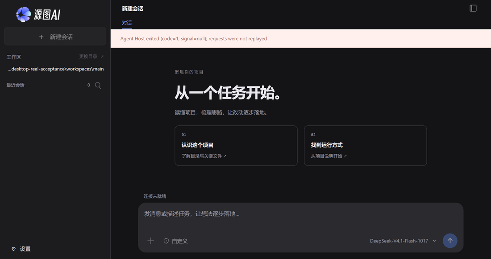
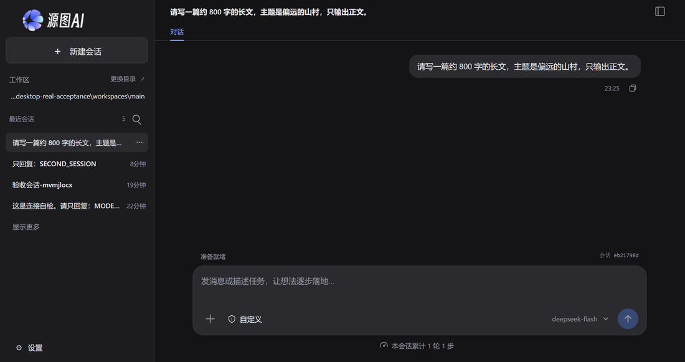
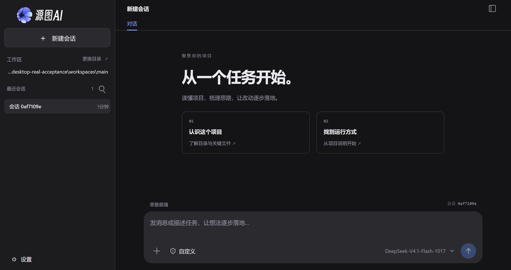
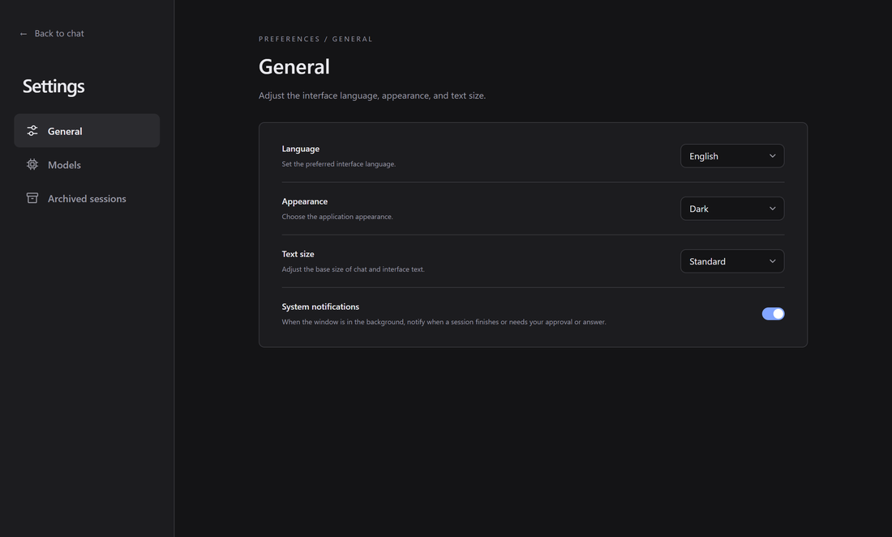
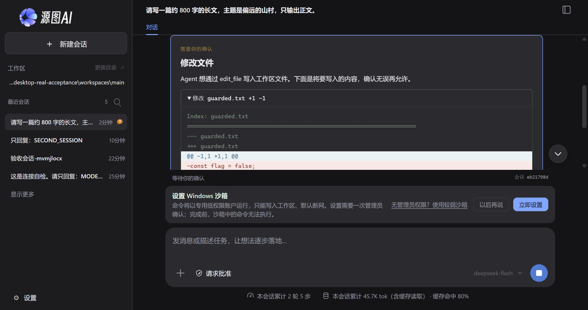
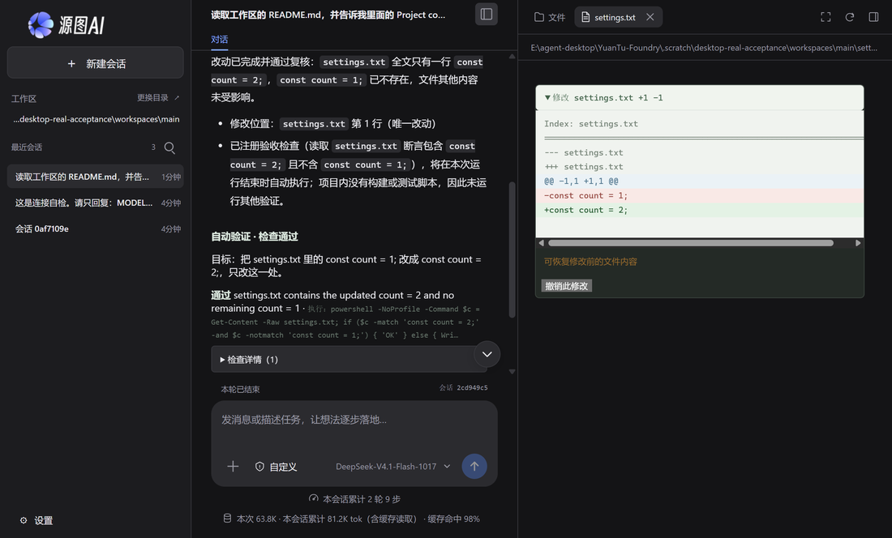
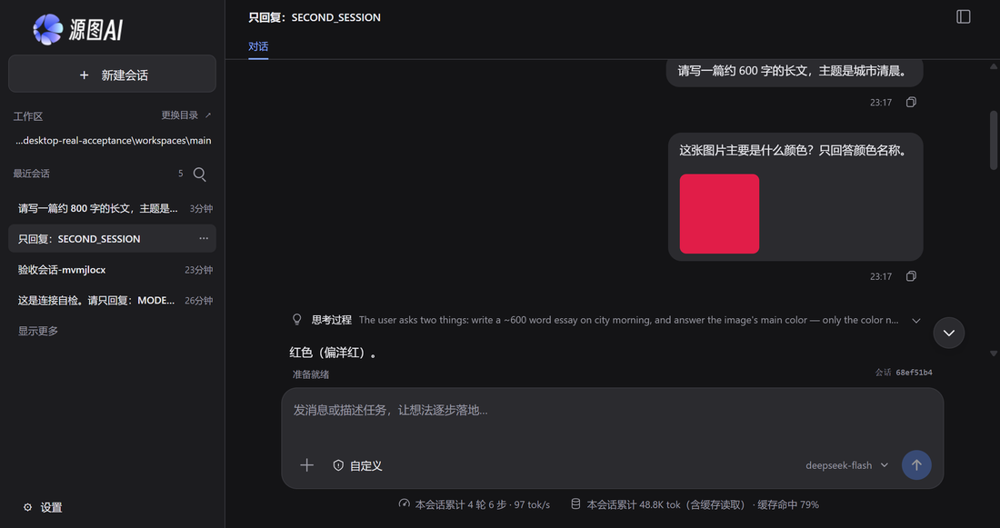
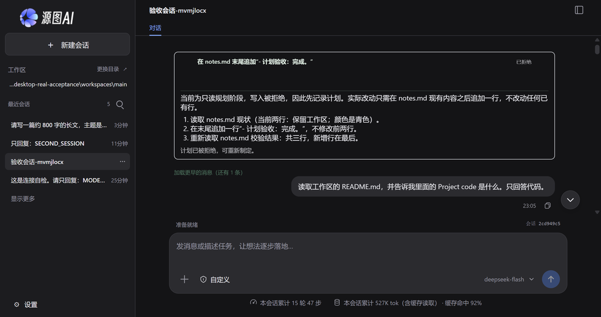
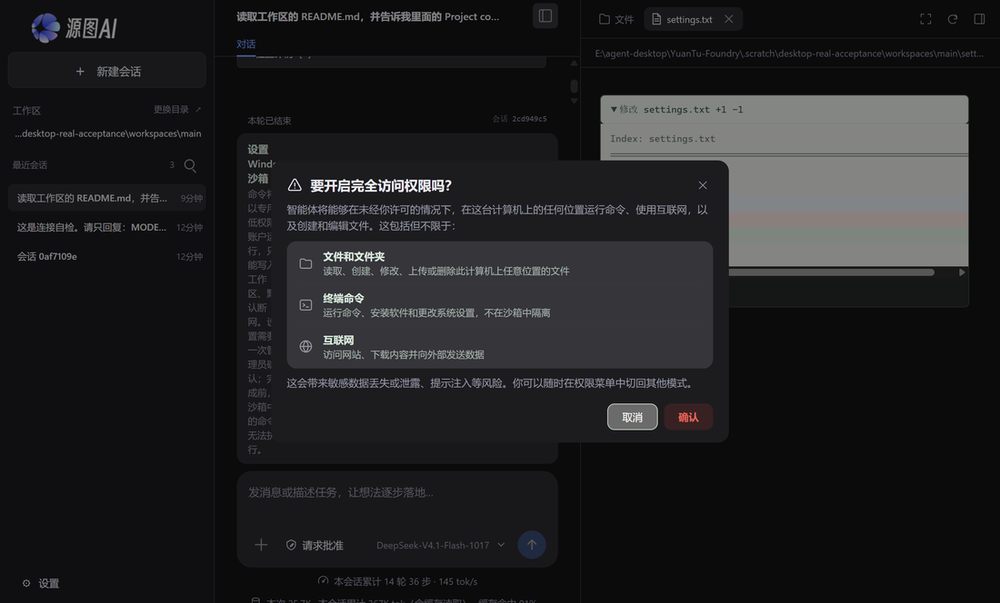
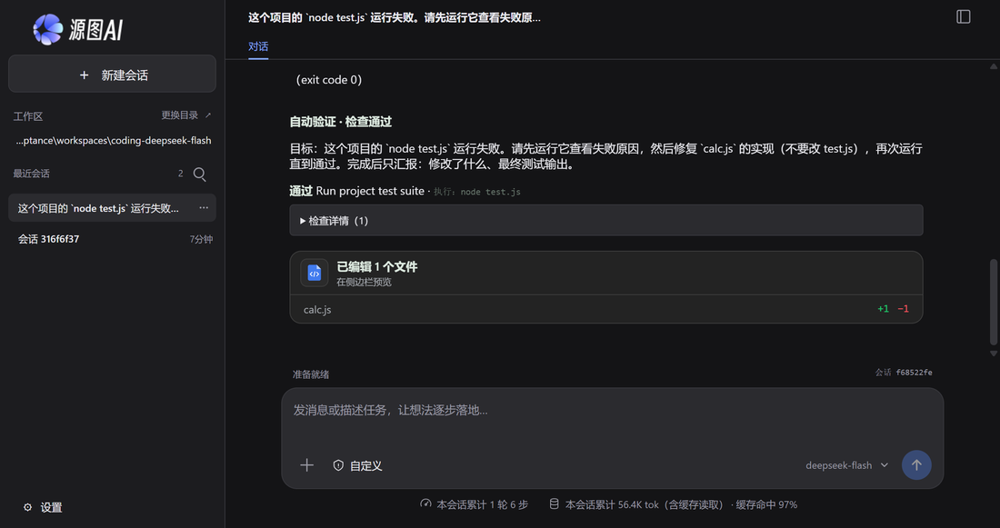

# 真实模型桌面验收报告：四个模型、桌面全流程与权限边界

> 日期：2026-10-24。仓库：`E:\agent-desktop\YuanTu-Foundry`，基线 `a8d3bca`（工作区干净）。
> 方式：驱动真实 Electron 桌面进程（真实主进程、IPC、Host 子进程、渲染层），使用系统 `safeStorage` 解密的四条真实模型连接；不是模拟 provider，也不是只跑单元测试。
> 产物：完整结果 `results-main.json` / `results-coding.json`、截图与日志在本机 `.scratch/desktop-real-acceptance/`（该目录被 Git 忽略）；本报告引用的截图已复制到 `docs/assets/2026-10-24-desktop-real-model-acceptance/`。

## 1. 结论摘要

**桌面主链路可用，四个真实模型都能完成单轮问答；三条连接完成了端到端编码任务，GPT-6-Astra 在多工具并行调用上被网关卡死。**

- 桌面自动化检查 **42 项**：39 通过、3 告警、0 失败。告警分别是未知 `YUANTU_*` 环境变量（见 5.2）、GPT 并行工具调用（见 5.1）、Windows 沙箱未初始化（见 5.5）。
- 跨模型编码任务 **4 项**：3 通过（DeepSeek-V4.1-Flash-1017、GLM-5.3、deepseek-flash），1 失败（GPT-6-Astra）。
- 桌面外壳、会话、审批、撤销、流式、停止、视觉、导出、计划、重启恢复均在本机真实窗口里跑通；三种窗口尺寸无横向溢出，英文界面无残留中文。
- 主要风险不在桌面代码，而在**网关对并行工具调用的实现**：GPT-6-Astra 单次工具调用参数正常，一旦同一轮并行发起 2 个以上工具调用，所有参数都以空串流回，模型重试三次后放弃。已用独立线上探针确认这是网关侧行为，DeepSeek-V4.1-Flash-1017 在同一网关的同一请求形状下参数完整。
- 另有三处产品体验缺口：未知环境变量导致 Host 启动失败却只在模型设置页给出原因；运行中关闭窗口后原会话没有任何“已中断”标记；只读预设把策略拒绝写成“用户拒绝”。

建议的处置顺序：

1. 在桌面侧识别“并行工具调用参数全为空”的响应并向用户明示网关不兼容，或对该路由关闭并行工具调用；同时向上游网关报缺陷（不阻塞其他三个模型）。
2. 把 `environmentProblems` 提到启动失败横幅/设置入口，而不是只藏在模型设置页。
3. 为中断的回合写入可见标记（`interrupted` 或运行级提示），并把只读/策略拒绝与用户拒绝分成两种文案。
4. 把 Windows 原生沙箱初始化写成明确的安装后置条件；初始化前不要让用户以为“命令已就绪”。

## 2. 测试环境

| 项目         | 值                                                                                          |
| ------------ | ------------------------------------------------------------------------------------------- |
| 操作系统     | Windows 11 Home China 10.0.26300，64 位                                                     |
| CPU / 内存   | AMD Ryzen 9 4900HS（16 逻辑核）/ 15.4 GB                                                    |
| 运行时       | Node.js 24.19.0，Electron 43.5.0（Chromium 150.0.7871.250）                                 |
| 应用构建     | `dist/desktop/main.cjs`，2026-10-24 20:11，来自 `a8d3bca`                                   |
| 桌面启动方式 | `dist/desktop/main.cjs` + `--user-data-dir=<隔离 profile>`，`YUANTU_WORKSPACE=<隔离工作区>` |
| 命令后端     | `YUANTU_SANDBOX=host`（原因见 2.2）；权限预设仍通过真实菜单切换                             |
| 测试时间     | 主套件 23:02–23:18（15 分 37 秒），编码矩阵 23:18–23:22（约 4 分钟）                        |

### 2.1 隔离的用户配置

桌面的模型密钥由 Chromium 的 OSCrypt 密钥（`Local State`）保护，只有密文 `model-settings.json` 无法在另一个 `--user-data-dir` 中解密。因此测试在 `.scratch/desktop-real-acceptance/profile` 中复制了：

- `model-settings.json`（四条连接、密钥密文）；
- `Local State`（同一 Windows 用户下的 OSCrypt 主密钥，缺少它时 `safeStorage.decryptString` 会失败，桌面会显示“尚未配置模型”）；
- `ui-settings.json`（中文、深色、标准字号）。

真实 `%APPDATA%\YuanTu Agent` 下的会话、备份、窗口状态没有被写入或删除；测试会话都落在隔离工作区的 `.yuantu/sessions.sqlite`。

### 2.2 为什么功能类命令用 host 后端

本机没有初始化 YuanTu 的 Windows 账户沙箱（`Get-LocalUser` 中只有 Codex 的沙箱账户，没有 YuanTu 账户），初始化需要一次管理员确认，当前会话没有可交互的 UAC。原生预设（仅可查看/请求批准/帮我批准）仍按真实 UI 切换并验证了文件审批、拒绝、沙箱提示和弱沙箱回退；需要真正执行命令的流程使用 host 后端。这个边界在 5.5 单独记录。

### 2.3 测试方法

- 每台应用都是真实 Electron 窗口，由 Playwright `_electron` 启动；UI 操作走真实 DOM 事件，不使用内部 IPC 代替点击。
- 断言尽量落在可观察事实：磁盘文件内容、真实命令输出、会话 SQLite 投影、DOM 文本、Host 退出码、截图。
- 每个场景独立捕获异常并截图，不因单个失败中止整套；失败后重试只用于测试夹具问题（视觉 PNG 未生成、工作区预览标签页未切回文件树），复测结果合并回总表，明细见附录 A。
- 真实模型调用约 45 个回合（含工具回环），矩阵与编码任务共 4 条连接；密钥不出现在报告、日志或 DOM 断言中。

## 3. 模型连接

| 连接       | 模型                     | 协议 / 端点                                  | 单轮首字 | 单轮总耗时 | 输入/输出 token | 备注                        |
| ---------- | ------------------------ | -------------------------------------------- | -------- | ---------- | --------------- | --------------------------- |
| `isrc`     | DeepSeek-V4.1-Flash-1017 | OpenAI Chat Completions，`llmapi.isrc.ac.cn` | 4.00 s   | 4.50 s     | 8,588 / 6       | 缓存命中 8,576              |
| `isrc`     | GPT-6-Astra              | 同上                                         | 14.82 s  | 15.27 s    | 6,543 / 8       | 并行工具调用参数丢失（5.1） |
| `isrc`     | GLM-5.3                  | 同上                                         | 23.28 s  | 23.80 s    | 8,278 / 6       | 本次缓存命中 0，延迟波动大  |
| `deepseek` | deepseek-flash           | OpenAI Chat Completions，`api.deepseek.com`  | 0.89 s   | 1.16 s     | 8,660 / 6       | 缓存命中 8,448              |

- 四条连接都由模型设置页读入并解密成功；设置页“测试连接”对 `isrc` 组返回“连接成功，模型已返回响应”，耗时 1.27 s。
- 错误密钥测试返回 `HTTP 401: Invalid token`；密钥没有回显到 DOM，错误信息可行动。
- 同一会话内依次切换四个模型，四条用户消息的 `modelInfo` 依次记录为四个 `connectionId`，与切换顺序完全一致；切换模型会重启 Host，但会话 id 和已有消息保持不变。

## 4. 结果总览

| 分组                   | 检查   | 通过   | 告警  | 失败  |
| ---------------------- | ------ | ------ | ----- | ----- |
| 环境与启动             | 2      | 1      | 1     | 0     |
| 桌面外壳               | 7      | 7      | 0     | 0     |
| 模型矩阵与设置         | 9      | 8      | 1     | 0     |
| 核心会话与工具         | 12     | 12     | 0     | 0     |
| 权限与沙箱             | 5      | 4      | 1     | 0     |
| 会话管理               | 5      | 5      | 0     | 0     |
| 重启与恢复             | 2      | 2      | 0     | 0     |
| **合计**               | **42** | **39** | **3** | **0** |
| 跨模型编码（独立套件） | 4      | 3      | 0     | 1     |

## 5. 发现

### 5.1 GPT-6-Astra：并行工具调用参数全部丢失（高，网关侧）

**现象。** 同一轮并行发起 2 个以上工具调用时，所有调用的 `arguments` 都是空对象；只有不需要参数的工具（`list_files`）成功。模型收到 `Invalid arguments: data must have required property 'path'/'command'`，重试 2–3 轮后放弃。

**复现（两次编码任务，结果一致）。**

- 第 1 次：11 次工具调用，3 个并行组分别 3/4/4 个调用，参数全为 `{}`；最终文本承认“未完成”，运行状态仍是 `completed`。
- 第 2 次：9 次工具调用，2 个并行组 4/5 个调用，参数全为 `{}`。
- 单次调用的同一模型（`MODEL-08` 第一段）读取 README 成功，`read_file` 参数为 `{path, start_line, end_line}`，说明连接、密钥、协议、工具 schema 本身都正常。
- 线上探针（不经过桌面）用同一密钥、同一端点、四个工具请求同一句话：GPT-6-Astra 的四个并行调用 `arguments` 均只收到空串；同形状请求下 DeepSeek-V4.1-Flash-1017 收到完整 JSON 参数。结论是网关/模型侧的并行调用实现丢失参数，桌面只是如实执行了空参数。

**影响。** 只要任务需要并行读文件或同时跑命令，GPT-6-Astra 连接就不可用；模型会浪费约 60–90 秒重试，最后仍以 `completed` 结束，用户需要自己从文本判断失败。

**建议。** 桌面在工具参数校验失败且同一轮多个调用都为空时，明确提示“该端点不支持并行工具调用”；如网关支持 `parallel_tool_calls: false`，对该路由默认关闭并行；同时向上游报缺陷。不要把它归因于工具 schema 或用户提示词。

**证据。** `results-coding.json` 的 `CODING-GPT-6-Astra` 指标、`probe-wire-parallel.log`、`results-main.json` 的 `MODEL-08`。

### 5.2 未知 `YUANTU_*` 变量让 Host 直接退出，原因藏在模型设置页（中）

**现象。** 从带有拼错变量的 shell 启动桌面时，Host 在约 1 秒内退出，横幅只说“Agent Host exited (code=1, signal=null); requests were not replayed / 连接未就绪”，提示框不可用。模型设置页的 `settings.error` 才写明“启动环境中的设置无法生效：`YUANTU_ACCEPTANCE_UNKNOWN`: unknown setting”，通用设置页不显示。

**复现。** `ENV-02`：在启动环境加入 `YUANTU_ACCEPTANCE_UNKNOWN=probe-value`，其余不变。约 1.15 s 后 Host 失败；去掉该变量立即恢复正常启动。测试脚本本身也踩过这个坑：`YUANTU_ACCEPTANCE_PYTHON` 曾让首轮启动全部失败。

**影响。** 高级用户/自动化环境里一个拼写错误就让应用“打不开”，且首屏不指向原因；排障需要先猜到去模型设置页看。

**建议。** 把 `environmentProblems` 放到启动失败横幅和设置入口；或在主进程过滤未知 `YUANTU_*`，只告警不致命。

**证据。** `unknown-env.png`、`ENV-02` 指标中的完整错误文本。



### 5.3 运行中关闭窗口，原会话没有任何“已中断”标记（中）

**现象。** 在指定会话中发送长文请求，确认 `running=true` 后 2.5 秒关闭应用；重启并重新点开同一个会话：状态 `idle`、`running=false`、无审批，消息列表只剩 3 条用户消息（其中两条是运行时上下文快照），**没有 assistant 消息，也没有 interrupted 标记**。界面只显示用户的问题和发送时间。

**影响。** 用户关闭窗口（或应用崩溃）后重开，看到的是一条永远没有回答的提问，无法区分“被中断”“还在排队”还是“模型没有回”。

**说明。** 不自动续跑是符合现有设计的；问题只在缺少可见的中断标记。运行记录、审计与恢复提示仍有改进空间。

**建议。** 在 `run.cancelled`/窗口退出路径写入一条 `interrupted` 的 assistant 占位或运行级提示；重开会话时显示“上次运行在关闭窗口时中断”。

**证据。** `probe-crash.log`、`probe-crash-view.log`、`crash-recovered-session.png`（补充探针，不计入 42 项主表）。



### 5.4 只读预设把策略拒绝写成“用户拒绝”（低）

**现象。** 切到“仅可查看”后请求修改 `notes.md`：文件没有变化，也没有审批卡；但工具结果是 `Permission denied by user. Do not retry the operation without new authorization.`，模型据此回答“本次写入被用户拒绝”。

**影响。** 用户从未看到审批，却被模型告知“你拒绝了”；容易让人误以为自己点错了或需要重新授权。

**建议。** 只读/策略拒绝使用与用户拒绝不同的错误文本（例如 `Blocked by the session's read-only permission policy`），并在工具卡片上显示“只读模式”而不是“被拒绝”。

**证据。** `PERM-01` 的 `toolText` 和最终回答。

### 5.5 Windows 原生沙箱需要管理员，未初始化前命令不可执行（环境边界）

- 选择“仅可查看/请求批准/帮我批准”会切换到原生账户沙箱并弹出“设置 Windows 沙箱”：命令需要管理员确认，完成前沙箱命令被拒绝；文件编辑审批不受影响（`PERM-02` 在提示存在时仍可审批并落盘）。
- 授权命令后，Host 返回 `The Windows sandbox accounts have not been initialized...`，模型如实解释而不是伪造输出（`PERM-04`）。
- “无管理员权限？使用较弱沙箱”会弹确认，确认后 chip 变为“较弱沙箱”、沙箱提示消失；但执行 `node -e` 时被 `The restricted token did not confine a write outside the workspace; execution refused` 拒绝——这是后端的失败安全，不是静默越权。
- 结论：**不初始化原生沙箱，受控预设下无法运行任何命令**。这是部署前置条件，不是本次发现的代码缺陷；建议在安装/首次启动时把“命令需要管理员初始化”讲清楚，并在未初始化时不要显示“准备就绪”。

### 5.6 其他观察（不计缺陷）

- **状态语义。** GPT 编码任务在“所有工具都失败、模型明确说未完成”时仍以 `completed` 结束。文本回答被判定为完成是现有设计，但对用户不够醒目；可考虑在“本轮所有工具调用均失败”时给 `needs_review`/失败提示。
- **计划模式的提问超时。** `/plan` 场景里规划器先调用提问，等待 60 秒超时后自行提交计划（整个场景 172.7 秒）。真实用户会回答问题，但超时路径会无谓地拖长计划生成；建议在 UI 上更醒目地提示“计划正在等待你的回答”。
- **延迟波动。** 同一网关同一时段，6 个 token 的回复从 4.5 秒到 23.8 秒；编码任务从 64 秒到 86 秒。桌面没有超时失败，但用户感知差异明显。
- **自动验证开销。** 普通命令场景出现 8 个工具结果（含记忆写入和自动校验），单轮输入约 2 万 token；属于现有自动验证/记忆机制，不算缺陷。

## 6. 桌面外壳

| 检查                          | 结果                                                                                                 | 证据                   |
| ----------------------------- | ---------------------------------------------------------------------------------------------------- | ---------------------- |
| 冷启动到可输入                | 1.15 s                                                                                               | `startup.png`          |
| 1280×800 / 1024×720 / 900×640 | 三种尺寸均无横向溢出，输入区完整；侧栏 272→230 px                                                    | `layout-*.png`（本机） |
| 英文界面                      | 切到 `en-US` 后可见文本剩余 CJK = 0（语言选择器里的“简体中文”按母语名保留）                          | `english-settings.png` |
| 外观/字号                     | 深色→浅色生效；字号 large 后输入区 14→16 px，根属性 `data-font-size=large`                           | —                      |
| 页面重载                      | 会话 id 与内容恢复，无错误横幅                                                                       | `after-reload.png`     |
| 工作区切换                    | 切到另一个目录再切回，工作区标题与输入区状态正确                                                     | —                      |
| 渲染层安全                    | `window.require`/`window.process` 均为 `undefined`；非法 IPC 返回 `ok:false`；DOM 无 `sk-…` 密钥模式 | —                      |
| 进程/内存                     | 4 个进程，主进程 117 MB，总工作集 534 MB                                                             | —                      |

标题栏、窗口尺寸、主题、语言、字体和布局都是真实 Chromium 渲染；截图见 `startup.png` 与 `english-settings.png`。



英文设置页（切换语言后真实渲染）：



## 7. 核心会话与工具

| 场景                | 结果 | 关键数据                                                                        |
| ------------------- | ---- | ------------------------------------------------------------------------------- |
| 读文件并引用内容    | 通过 | 4.75 s，1 个工具结果，17,277 输入 / 76 输出 token，回答 `ALPHA-7319`            |
| 自动批准编辑 + 撤销 | 通过 | 72.5 s，7 步，63,160 / 679 token；diff 224 字符；撤销后文件恢复原样             |
| 多轮上下文          | 通过 | 先记 42，再问“刚才的数字”，回答 `42`（8.3 s）                                   |
| 普通命令            | 通过 | `node -e "console.log(6*7)"` 输出 42；23.3 s，8 个工具结果（含记忆/自动校验）   |
| 风险命令审批        | 通过 | 命令含 `curl`，10.2 s 后出现审批；允许后真实执行并回显输出                      |
| 流式输出            | 通过 | 307 字，9.9 s，`#live` 区域 14 次渐进绘制，结束后落入消息                       |
| 运行中停止          | 通过 | 状态“已停止”；随后新请求 9.2 s 正常完成                                         |
| 图片附件/视觉       | 通过 | 96×96 深红 PNG；识别为“红色（偏洋红）”；10.1 s，8,923 / 733 token               |
| 导出 Markdown       | 通过 | 真实保存对话框路径，4,863 字符，含运行时上下文与问答                            |
| 计划模式            | 通过 | 3 步计划，标题/摘要/步骤完整；拒绝后 plan 面板关闭；172.7 s（含 60 s 提问超时） |
| 工作区文件预览      | 通过 | 文件树 → README 预览，内容含 `ALPHA-7319`                                       |

文件改动的审批与差异预览（请求批准预设）：



自动批准模式下的 diff 与撤销入口：



视觉附件与回答：



计划面板：



## 8. 权限与沙箱

| 检查                     | 结果                 | 观察                                                                 |
| ------------------------ | -------------------- | -------------------------------------------------------------------- |
| 仅可查看                 | 通过（告警见 5.4）   | 文件未变；无审批卡；模型称“用户拒绝”                                 |
| 请求批准 + 审批          | 通过                 | 22.6 s 后出现审批；差异预览含 `guarded.txt`；允许后落盘              |
| 拒绝审批                 | 通过                 | 1 次拒绝；`denied.txt` 不存在；模型收敛，不重试                      |
| 未初始化原生沙箱执行命令 | 告警（环境边界）     | 审批后 Host 拒绝；模型解释需初始化，未伪造输出                       |
| 完全访问权限             | 通过                 | 确认对话框 209 字符；取消保持“请求批准”；确认后自动写入成功          |
| 弱沙箱回退（补充探针）   | 通过（后端拒绝执行） | 确认后 chip=“较弱沙箱”，提示消失；`node -e` 被受限令牌的写入检查拒绝 |

完全访问权限的确认对话框（真实窗口）：



## 9. 会话、重载与重启

- **重命名**：当前会话 → “验收会话-mvmjlocx”，侧栏与标题同步；重载后保留。
- **搜索**：按名称前缀搜索返回 3 条匹配；清空恢复完整列表。
- **切换**：新建会话发送一轮后切回旧会话，旧会话 100 条消息完整恢复；历史加载是异步的，自动断言需要等待消息到达。
- **删除**：删除一个空会话，列表项消失，随后可重新选中保留会话。
- **重载**：100 条消息、0 个待审批恢复。
- **重启**：关闭应用再启动，模型选择保持不变（DeepSeek-V4.1-Flash-1017），4 个会话在列，启动 1.16 s，无残留错误。
- **运行中关闭**：补充探针见 5.3；主套件 `RESTART-02` 只验证了“重启后无 running/审批残留”，没有在同一会话上验证部分输出。

## 10. 跨模型编码任务

任务：在隔离工作区运行 `node test.js`，它会因为 `calc.js` 的 `add` 实现成了减法而失败；要求先跑测试、只修 `calc.js`、不改测试，再跑通。独立复核：测试文件字节未变，`node test.js` 输出 `TEST_PASS`。

| 模型                     | 结果        | 总耗时 | 步数 | 工具调用         | 输入/输出 token | 首 token（平均） |
| ------------------------ | ----------- | ------ | ---- | ---------------- | --------------- | ---------------- |
| DeepSeek-V4.1-Flash-1017 | 通过        | 68.5 s | 6    | 6                | 55,629 / 439    | 1.8 s            |
| GPT-6-Astra              | 失败（5.1） | 86.5 s | 4    | 11（全部空参数） | 22,640 / 456    | 16.9 s           |
| GLM-5.3                  | 通过        | 64.0 s | 5    | 6                | 44,268 / 765    | 13.9 s           |
| deepseek-flash           | 通过        | 10.2 s | 6    | 6                | 55,904 / 481    | 0.9 s            |

三个通过模型的最终回答都明确写出“`return a - b` 改为 `return a + b`、未改 `test.js`、`TEST_PASS`”，与磁盘和独立测试结果一致；没有出现修改测试来“骗过”验证的情况。



## 11. 覆盖与未覆盖

**已覆盖。**

- 桌面外壳：启动、布局、语言、主题、字号、重载、工作区切换、渲染层安全、进程内存。
- 模型：四条连接的解密、切换、逐轮记录、连接测试、错误密钥。
- 会话与工具：读写文件、diff/撤销、命令、风险命令审批、拒绝、停止、多轮上下文、流式、视觉、导出、计划、工作区预览。
- 权限：仅可查看、请求批准、拒绝、完全访问确认、原生沙箱提示、弱沙箱回退。
- 会话管理：重命名、搜索、切换、删除、重载、重启、运行中关闭。
- 编码：同一任务在四个真实模型上的端到端对比。

**未覆盖或只到边界。**

- 打包安装包（NSIS）、升级/回滚、签名校验；本报告只测了开发构建。
- Windows 原生沙箱的**管理员初始化**与初始化后的命令隔离（当前会话没有可交互 UAC）。
- MCP/OAuth、知识库索引、子代理、后台任务、持久目标/定时任务、上下文压缩与长会话。
- 系统通知、无障碍、键盘全流程、外链打开（真实模型输出触发）与多实例互斥。
- macOS/Linux 与 Seatbelt；本机只测 Windows。
- 真实网络故障/断网切换；只测了错误密钥和未初始化沙箱两种失败。
- 视觉只测了纯色小图，没有测多图、尺寸上限、文档附件（docx/pdf）读取。

## 12. 复现方式

测试脚本与结果都在 `.scratch/desktop-real-acceptance/`（Git 忽略，不随仓库分发）：

```powershell
# 1) 生成隔离 profile 与工作区（会删除旧的 .scratch profile/workspaces/evidence）
$env:ACCEPTANCE_PYTHON = 'C:\...\python.exe'   # 可选，仅用于生成视觉夹具
node .scratch/desktop-real-acceptance/prepare.mjs

# 2) 完整主套件（42 项）
node .scratch/desktop-real-acceptance/run-main.mjs

# 3) 只重跑某一项（逗号分隔前缀）
node .scratch/desktop-real-acceptance/run-main.mjs CORE-06,MODEL-08

# 4) 跨模型编码矩阵（4 项）
node .scratch/desktop-real-acceptance/run-coding.mjs
```

- 主结果：`.scratch/desktop-real-acceptance/results-main.json`（及自动生成的 `.md`）；编码结果：`results-coding.json`。
- 截图：`.scratch/desktop-real-acceptance/evidence/`；日志：`run-final-main.log`、`run-final-coding.log`、`probe-*.log`。
- 注意：**不要从 shell 导出任何未登记的 `YUANTU_*` 变量**。测试进程要设置 `YUANTU_SANDBOX=host` 时只通过脚本内部的 `env` 传入；外层环境里出现未知名字会触发 5.2 的 Host 退出。
- 复制 profile 时必须同时复制 `Local State`，否则 `safeStorage` 无法解密，桌面会显示“尚未配置模型”。
- 真实模型连接来自本机 `%APPDATA%\YuanTu Agent\model-settings.json`；换机器需要重新配置，报告不包含任何密钥。

## 13. 结论

以“真实桌面 + 真实模型”为标准，YuanTu 桌面的核心闭环是成立的：**模型能读、能改、能跑、能审批、能撤销、能流式输出、能恢复会话**，四个模型连接都能完成基础问答，三个模型能独立完成一个需要读、改、跑的小型编码任务。权限预设、完全访问确认、拒绝与停止路径都没有出现崩溃或数据损坏。

需要在上线/推荐前处理的三件事：

1. **GPT-6-Astra 连接**：在网关修复并行工具调用之前，把它标注为“仅单工具调用可用”，或在桌面侧检测并提示；否则用户会看到一个“完成”但实际上什么都没做的回合。
2. **环境变量与启动失败的可见性**：未知 `YUANTU_*` 不应只剩“Agent Host exited”；把原因放到首屏。
3. **中断与只读的语义**：运行中关闭窗口要有可见的中断标记；只读拒绝不要写成“用户拒绝”。

Windows 原生沙箱的管理员初始化是本机环境的硬前置条件；在未初始化的机器上，即使权限预设看起来已经就绪，命令仍会被拒绝。建议在安装/首次启动流程里把它作为明确步骤，而不是仅在出错后用一段提示兜底。

## 附录 A：检查明细

| 编号                            | 分组 | 结果 | 说明                                                   |
| ------------------------------- | ---- | ---- | ------------------------------------------------------ |
| ENV-01                          | 环境 | 通过 | win32 x64 · Electron 43.5.0 · DeepSeek-V4.1-Flash-1017 |
| ENV-02                          | 环境 | 告警 | 未知 `YUANTU_*` 导致 Host 退出；设置页给出明确原因     |
| SHELL-01                        | 外壳 | 通过 | 三种窗口尺寸无横向溢出                                 |
| SHELL-02                        | 外壳 | 通过 | 英文界面 0 个残留 CJK                                  |
| SHELL-03                        | 外壳 | 通过 | 浅色主题与 14→16 px 字号生效                           |
| SHELL-04                        | 外壳 | 通过 | 无 Node 全局、非法 IPC 被拒、无密钥入 DOM              |
| SHELL-05                        | 外壳 | 通过 | 重载后会话恢复                                         |
| SHELL-06                        | 外壳 | 通过 | 4 进程 / 534 MB 工作集                                 |
| SHELL-07                        | 外壳 | 通过 | 切换工作区并返回                                       |
| MODEL-00                        | 模型 | 通过 | 新建矩阵会话                                           |
| MODEL-01                        | 模型 | 通过 | DeepSeek-V4.1-Flash-1017，4.50 s                       |
| MODEL-02                        | 模型 | 通过 | GPT-6-Astra，15.27 s                                   |
| MODEL-03                        | 模型 | 通过 | GLM-5.3，23.80 s                                       |
| MODEL-04                        | 模型 | 通过 | deepseek-flash，1.16 s                                 |
| MODEL-05                        | 模型 | 通过 | 四轮模型标识顺序正确                                   |
| MODEL-06                        | 模型 | 通过 | 设置页测试连接 1.27 s                                  |
| MODEL-07                        | 模型 | 通过 | 错误密钥 401，密钥不回显                               |
| MODEL-08                        | 模型 | 告警 | 单调用正常；12 个并行调用全部空参数                    |
| CORE-00                         | 核心 | 通过 | 独立会话                                               |
| CORE-01                         | 核心 | 通过 | 读取 README 并引用 ALPHA-7319                          |
| CORE-02                         | 核心 | 通过 | 编辑 1→2，diff，撤销恢复                               |
| CORE-03                         | 核心 | 通过 | 多轮记忆 42                                            |
| CORE-04                         | 核心 | 通过 | 命令输出 42                                            |
| CORE-05                         | 核心 | 通过 | 风险命令审批后执行                                     |
| CORE-06                         | 核心 | 通过 | 14 次渐进渲染                                          |
| CORE-07                         | 核心 | 通过 | 停止后恢复对话                                         |
| CORE-08                         | 核心 | 通过 | 视觉识别红色                                           |
| CORE-09                         | 核心 | 通过 | 导出 4,863 字符                                        |
| CORE-10                         | 核心 | 通过 | 3 步计划，拒绝                                         |
| CORE-11                         | 核心 | 通过 | 工作区预览 README                                      |
| PERM-01                         | 权限 | 通过 | 只读阻止写入（文案问题见 5.4）                         |
| PERM-02                         | 权限 | 通过 | 审批后落盘，差异可见                                   |
| PERM-03                         | 权限 | 通过 | 拒绝后文件不存在                                       |
| PERM-04                         | 权限 | 告警 | 原生沙箱未初始化，命令被拒                             |
| PERM-05                         | 权限 | 通过 | 完全访问确认与自动写入                                 |
| SESSION-01                      | 会话 | 通过 | 重命名                                                 |
| SESSION-02                      | 会话 | 通过 | 名称搜索                                               |
| SESSION-03                      | 会话 | 通过 | 新旧会话切换，100 条消息恢复                           |
| SESSION-04                      | 会话 | 通过 | 删除会话                                               |
| SESSION-05                      | 会话 | 通过 | 重载后 100 条消息、0 待审批                            |
| RESTART-01                      | 重启 | 通过 | 模型与 4 个会话恢复，启动 1.16 s                       |
| RESTART-02                      | 重启 | 通过 | 运行中关闭后无残留状态（补充探针见 5.3）               |
| CODING-DeepSeek-V4.1-Flash-1017 | 编码 | 通过 | TEST_PASS，68.5 s                                      |
| CODING-GPT-6-Astra              | 编码 | 失败 | 并行工具参数为空，86.5 s                               |
| CODING-GLM-5.3                  | 编码 | 通过 | TEST_PASS，64.0 s                                      |
| CODING-deepseek-flash           | 编码 | 通过 | TEST_PASS，10.2 s                                      |

## 附录 B：证据索引

| 截图                          | 内容                                   |
| ----------------------------- | -------------------------------------- |
| `startup.png`                 | 应用启动后的中文深色桌面               |
| `english-settings.png`        | 英文设置页（0 残留中文）               |
| `write-approval.png`          | 请求批准预设下的文件修改审批与 diff    |
| `edit-diff.png`               | 自动批准模式下的编辑差异与撤销入口     |
| `full-access-dialog.png`      | 完全访问权限的风险确认                 |
| `plan-panel.png`              | 计划面板与三步计划                     |
| `vision-answer.png`           | 图片附件与视觉回答                     |
| `coding-deepseek-flash.png`   | 编码任务完成后的自动校验与已编辑文件   |
| `unknown-env.png`             | 未知 `YUANTU_*` 变量导致的启动失败     |
| `crash-recovered-session.png` | 运行中关闭后重开的会话（缺少中断标记） |
