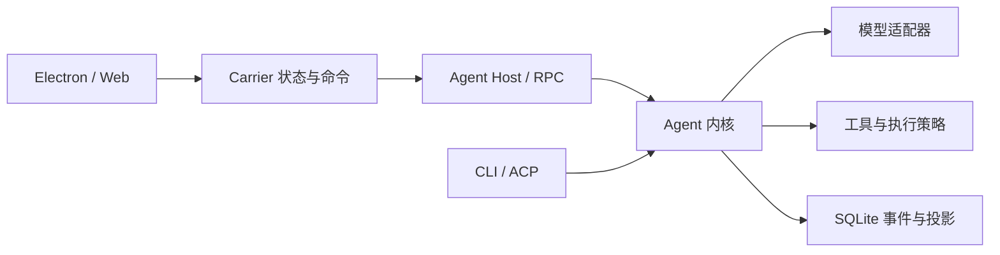

# YuanTu-Foundry 架构与能力评估

评估日期：2026-10-12（Asia/Shanghai）。

项目目录：`E:\agent-desktop\YuanTu-Foundry`。评估时 HEAD 为 `50911a2`，工作树包含大量已暂存修改和未跟踪文件；本文评估对象是当时的实际工作树，不代表该提交本身或正式发布版本的状态。

本文整理本次只读源码检查、依赖扫描和抽样验证结果。事实、工程判断、改进建议与未完成验收分别说明；不把历史验证结果当作当前通过证据。

## 1. 总体结论

项目已经具备完整本地编程 Agent 的产品骨架，能力覆盖较广，工程保障有基础。适合继续作为个人或内部团队的桌面编程工具迭代。

主要短板是核心依赖仍较紧、强隔离尚未完成验收，以及测试和文档的维护成本。目前证据不足以支持将其按强隔离、多租户服务平台交付。

下一阶段应优先稳定已有能力、明确模块所有权、补齐目标平台和发布验收，再扩大功能面。能力存在于源码中不等于真实复杂任务成功率已经达到某个水平；本次没有进行真实模型任务评测。

## 2. 架构形态

项目是模块化单体运行时，通过 Host 进程向界面和客户端提供能力。packages 是同一工程中的模块目录，并非已经独立发布或独立部署的服务。

以下是主要调用路径的概念图，省略了扩展注册、回调及部分跨模块依赖；它不是严格单向的完整依赖图。



| 模块或入口                               | 主要责任                                           | 当前评价                                       |
| ---------------------------------------- | -------------------------------------------------- | ---------------------------------------------- |
| packages/core                            | 模型请求、上下文、工具调度、运行状态、子代理与任务 | 内核功能集中，协调职责仍较多                   |
| packages/protocol                        | 消息、事件、RPC、权限、设置及执行契约              | 共享词表较明确，有利于多个入口一致             |
| packages/storage                         | SQLite 事件、投影、迁移、备份恢复、任务和流式记录  | 可靠性机制较完整，但仍依赖部分 core 业务逻辑   |
| packages/tools                           | 工具注册、审批、校验、超时、执行环境和资源清理     | 管线统一，扩展广，依赖面较大                   |
| packages/providers                       | 模型协议、SSE、缓存、发现和容量处理                | 模型接入与内核有清晰分工                       |
| packages/client / packages/carrier       | Host 通信、会话状态、命令、增量通道及恢复          | 可被不同界面复用，是应保留的架构接缝           |
| apps/shared                              | CLI 与 Host 的运行时装配                           | 减少入口之间的重复初始化                       |
| apps/agent-host                          | RPC 服务、运行生命周期及调度                       | 长驻运行与界面分离                             |
| apps/desktop / apps/web                  | 本地桌面与浏览器载体                               | Web 复用桌面渲染能力，当前不承担多人服务端职责 |
| apps/cli / apps/agent-acp / packages/sdk | 命令行、ACP 及嵌入接口                             | 入口覆盖广，兼容性应依靠契约测试保持           |

关键源码：[Agent](../packages/core/agent.ts)、[SessionStore](../packages/storage/sqlite.ts)、[CarrierService](../packages/carrier/service.ts)、[运行时装配](../apps/shared/runtime.ts)、[工具注册与执行](../packages/tools/registry.ts)。

### 2.1 应保留的设计

1. 多个入口复用同一内核，减少 CLI、Host、桌面和 Web 各自实现运行逻辑的机会。
2. Carrier 将界面与 Host 分开，会话状态、增量消息和恢复机制可以在不同载体间复用。
3. 持久事件与投影机制较完整，迁移、备份恢复、任务日志、流式检查点和租约均有实际实现。
4. 工具执行有统一管线，审批、策略、校验、超时、并发及清理不完全散落在各工具中。
5. 模型、工具、子代理和资源扩展有注册或装配接口，扩展能力已有基础。

### 2.2 当前结构限制

本次静态扫描覆盖 apps 和 packages 中 289 个生产 TypeScript 文件，排除 dist、target、node_modules。扫描静态 import/export，并区分显式类型导入与运行时依赖；未全面覆盖动态加载、回调或依赖注入。

包层面的运行时依赖形成一个较大的强连通分量，涉及 core、storage、tools、knowledge、resources、mcp、lsp 和 office。例如：core 依赖 storage/tools，storage 又调用 core 的任务规范化逻辑，tools 又依赖 core 及扩展模块。

这是模块边界和修改影响范围的信号，不能直接认定存在文件级循环加载故障，也不是已复现缺陷数量。

| 文件                                  | 扫描时约计行数（含空行） | 工程含义                       |
| ------------------------------------- | ------------------------ | ------------------------------ |
| packages/core/agent.ts                | 2,945                    | 主循环仍承载较多业务协调       |
| packages/storage/sqlite.ts            | 2,038                    | 存储入口仍有较多会话与任务职责 |
| packages/core/subagents.ts            | 1,690                    | 委派、结算和资源生命周期复杂   |
| packages/client/session-controller.ts | 1,291                    | 客户端会话状态管理规模较大     |
| packages/carrier/service.ts           | 1,210                    | 载体状态、命令与恢复逻辑集中   |

行数只用于定位审查重点，不单独证明设计质量低。后续应按状态所有权、生命周期和契约拆分；仅继续拆文件，可能保留原有耦合并增加跨文件跳转。

## 3. 能力评价

下表评价实现完整度与工程边界，不是端到端成功率、性能排名或发布认证。

| 能力                                      | 当前评价                       | 主要边界与后续验证                                   |
| ----------------------------------------- | ------------------------------ | ---------------------------------------------------- |
| 模型协议、流式响应、容量与上下文管理      | 实现较完整                     | 真实网关兼容性、长任务和复杂任务成功率需独立评测     |
| 文件、搜索、Git、终端、后台作业与工具管线 | 核心编程能力齐备               | 不同执行模式下能力有差异，工具清理和取消应持续回归   |
| 会话持久化、恢复、备份与迁移              | 工程投入较充分                 | 真实崩溃、磁盘故障、并发打开和升级场景需持续验收     |
| 子代理、任务、目标、计划与工作流          | 功能丰富                       | 状态、结果结算、重复执行防护和资源生命周期是维护重点 |
| MCP、LSP、Skills、资源、知识库与 Office   | 扩展面较广                     | 外部依赖、平台环境及接口支持范围需要明确             |
| Electron、Web、CLI、ACP 与 SDK            | 入口覆盖广                     | Web 当前是本地单连接桥，不能视为多人服务端           |
| 权限与 OS 沙箱                            | 有明确策略、能力声明和拒绝机制 | Windows 强隔离及跨平台真实验收尚不完整               |
| 测试、CI、构建与发布                      | 有分层门禁和平台任务           | 配置齐备不能代替最终工作树上的验证证据               |

本次 docs:check 通过，README 的生成事实表与其统计逻辑一致：空工作区基础工具 67 个、Host RPC 方法 50 个、行为测试文件 193 个、桌面冒烟套件 7 个。工具数量会受宿主、策略及工作区扩展影响；这些数字不是有效任务完成率，也不是逐项验收结果。

## 4. 已确认的能力边界与文档问题

### 4.1 Windows 基础沙箱只提供部分写入限制

[执行能力声明](../packages/tools/execution-capabilities.ts)明确将 Windows 基础后端的 processFiles 标为 workspace-write-partial，网络为 unrestricted。该后端不能作为完整读取隔离或断网保证；不支持的严格策略应明确拒绝。

权限审批与文件工具的路径检查也不能代替操作系统隔离。host 模式本身不提供 OS 隔离。

### 4.2 AppContainer 原型尚未接入公开运行模式

[AppContainer 后端](../packages/tools/sandbox-appcontainer.ts)已有原型实现，但当前[模式词表](../packages/tools/sandbox-mode.ts)和[公开后端注册](../packages/tools/sandbox.ts)没有将它作为公开模式启用。已有设置与初始化流程不能当作完整运行链路验收。

本次执行环境是 Node.js 24.19.0、libuv 1.52.1、Windows x64。[兼容性要求](../packages/tools/appcontainer-runtime.ts)要求 libuv >= 1.53.0。这个检查结果仅指本次使用的 Node 运行时，不能推定所有打包运行时版本相同。

需要在兼容运行时、可信发布资产和目标 Windows 环境中，证明实际文件/网络约束、子进程生命周期、取消、恢复与安全卸载；helper 单元测试或初始化退出成功不能替代这些证据。

### 4.3 Web 当前是本地单连接桥

[Web 桥](../apps/web/main.ts)检查本机回环连接和 token，并拒绝第二个活动页面连接。它复用 Carrier 与 Host，但没有在本次审查中展示租户隔离、多人会话仲裁或服务端集群能力。

这些是当前产品定位和部署模型的限制，不是将第二个页面拒绝认定为实现缺陷。

### 4.4 README 存在语义漂移

README 写非 host 模式拒绝全部原生 Git 工具，但[当前 Git 代码](../packages/tools/git.ts)已经可以通过 localExecutionEnvironment 启动 Git 读取；修改受保护仓库元数据的写操作仍要求显式 host 模式。[对应测试](../tests/native-git.test.ts)也覆盖执行环境归属和元数据保护，但其模拟后端不能作为真实 OS 隔离验收。

因此需要按读取、元数据写入、stdio MCP 等类别分别描述能力。不能因 docs:check 或 references:check 通过就认定所有文档语义正确：这些门禁主要验证生成内容和引用，不能替代源码语义审查。

### 4.5 发布可信度仍需完善

[打包配置](../electron-builder.config.cjs)对 Windows 设置 signExecutable: false。该事实说明可执行文件签名配置需要单独审查；本次没有检查最终安装器或发布二进制的实际签名状态，不能据此概括所有发布资产均未签名。

macOS 签名、公证、真实平台隔离以及安装升级链路也需要目标环境验收。本地构建或原型初始化不能替代发布验收。

## 5. 本次验证证据

### 5.1 通过的检查

| 检查           | 命令或范围                                                        | 实际结果                                                           |
| -------------- | ----------------------------------------------------------------- | ------------------------------------------------------------------ |
| 类型检查       | node node_modules/typescript/bin/tsc --noEmit --incremental false | 退出码 0                                                           |
| 文档统计       | npm.cmd run docs:check                                            | 通过                                                               |
| 引用检查       | npm.cmd run references:check                                      | 通过                                                               |
| i18n 检查      | npm.cmd run i18n:check                                            | 通过                                                               |
| 代表性抽样测试 | 下列 12 个文件，在正常本地环境运行                                | 164 项：163 pass、0 fail、1 skip、0 cancelled、0 todo；约 73.18 秒 |

抽样命令：

```powershell
Set-Location -LiteralPath 'E:\agent-desktop\YuanTu-Foundry'
node scripts/run-tests.mjs tests/permissions.test.ts tests/invariants.test.ts tests/schema-migrations.test.ts tests/database-maintenance.test.ts tests/program-handshake.test.ts tests/host-reconnect.test.ts tests/carrier.test.ts tests/tool-parallel.test.ts tests/providers.test.ts tests/workflow.test.ts tests/acceptance.test.ts tests/native-sandbox-migration.test.ts
```

唯一跳过项是 POSIX acceptance 的同进程组后代清理测试，不适用于本次 Windows 环境。不能将该跳过记为 POSIX 平台通过。

本地完整日志：`.scratch/test-logs/1791767166930-12788-21b6af38-dda8-46ae-953a-9d3f84f355ee.log`。该目录受 Git 忽略，不随本文件交付；其他 agent 若无法读取，应重新运行命令并记录新的日志。

### 5.2 环境错误的处理

最初在受限执行环境运行同一组测试，出现临时目录 realpath/rename 的 EPERM 和回环连接 EACCES，部分断言随后受到影响。正常本地环境复跑同一组测试后通过，原受限测试进程及其子进程已结束。

本次不将这些错误列为已复现产品缺陷。也不能由正常环境通过，反推产品自己的 OS 沙箱已经验收通过；两者是不同的验证对象。

### 5.3 未执行的验收

- 全量行为测试及 check:full/check:release。
- coverage、bench:check 和实际任务性能对比。
- Electron 桌面与 Web 完整冒烟。
- Windows AppContainer 实际网络/文件隔离、UAC、发布签名及卸载恢复。
- macOS 真机 Seatbelt、子进程清理、签名和公证。
- 真实模型长任务、复杂代码修改质量、成本和成功率评测。

因此本报告不能作为当前工作树达到发布标准、所有能力均已验收或性能改善的证明。

## 6. 改进优先级与验收方向

以下是建议顺序，不表示本次已授权或开始执行全部改进。

| 顺序 | 工作                         | 目的                               | 可接受的完成证据                                                                                   |
| ---- | ---------------------------- | ---------------------------------- | -------------------------------------------------------------------------------------------------- |
| 1    | 完成隔离与发布边界的真实验收 | 让界面和文档承诺与实际执行保证一致 | 兼容运行时、目标 OS 的文件/网络/进程探针、取消恢复测试及发布资产验收；未完成前保持拒绝或未启用状态 |
| 2    | 按职责减少依赖回流           | 降低核心修改影响范围               | 明确存储、内核、工具装配的契约与所有权；公开 API 和行为保持；相关与全量回归通过                    |
| 3    | 执行测试体系重构             | 降低重复维护和反馈成本             | 能力矩阵、逐项删除/替代证据、默认入口无漏跑、门槛不降低；耗时优化有可比测量                        |
| 4    | 校正文档语义与支持范围       | 避免 agent 和用户基于过时边界操作  | Git/stdio MCP/沙箱能力描述与源码一致；路径、统计和 i18n 门禁通过                                   |
| 5    | 建立真实任务评测             | 判断能力是否能稳定产生用户结果     | 固定任务与验收标准，记录成功率、人工介入、恢复能力、耗时和成本；不只统计工具调用数                 |

测试重构可直接参照[测试体系重构执行计划](superpowers/plans/2026-10-12-test-suite-rebuild.md)，采用保护基线、能力映射、逐批替换和验收的流程，禁止先清空 tests。

任何架构调整应先确认当前工作树基线，保护已有暂存内容和未跟踪文件；不得将一次抽样通过当作大范围模块拆分的完整验收。

## 7. 后续 agent 使用说明

1. 先核对工作树、HEAD、运行时和本地指令。本文是日期快照，源码变化后应重新确认相关结论。
2. 将已确认边界作为审查起点，不将本报告的建议自动转换为产品缺陷或改动授权。
3. 需要执行改进时，把目标、拥有的文件、验证范围和完成标准写入独立计划；优先处理一个可验收主题。
4. 报告时分开写源码事实、复现结果、环境限制、工程判断和待验收项；不引用旧日志声称当前版本通过。
5. 当前文档交付不修改产品源码、测试或发布配置；提交与推送按会话授权执行。
