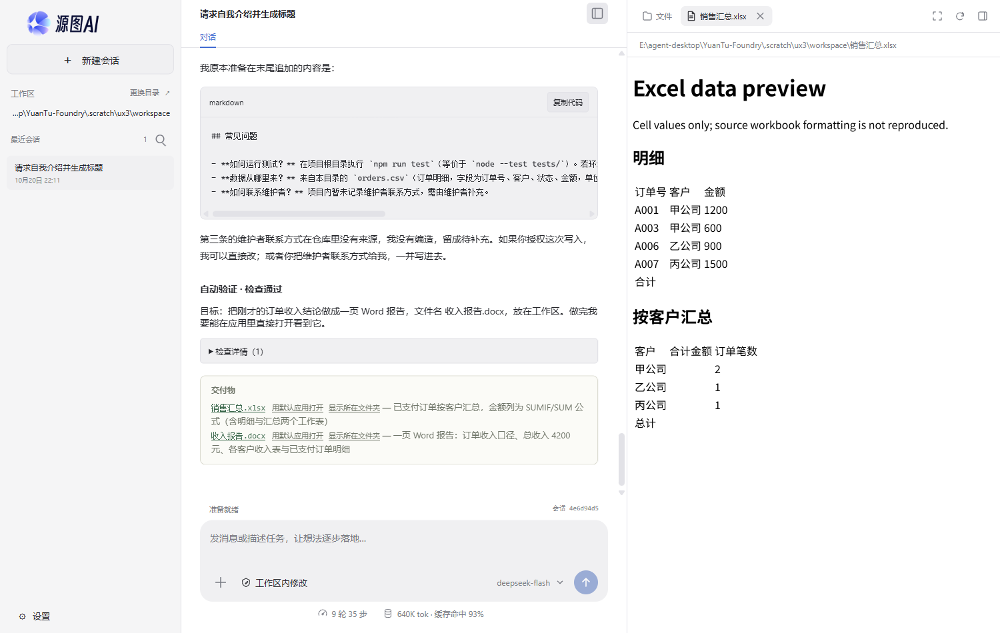
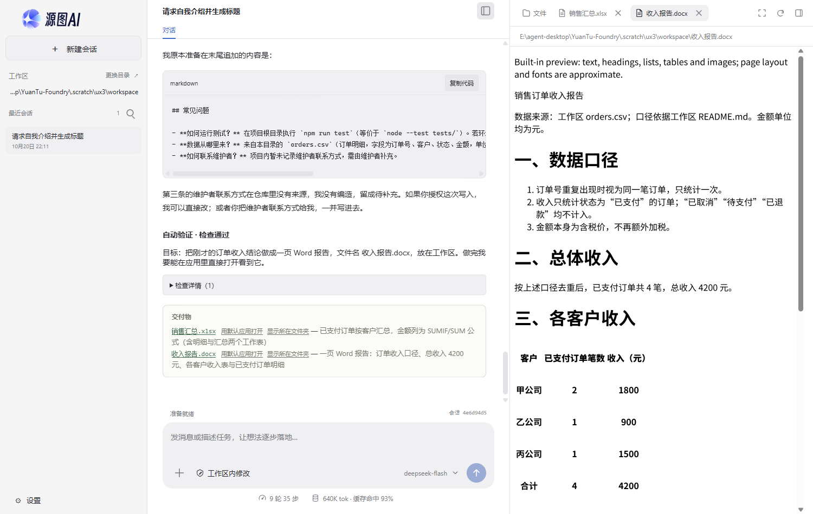

# 真实模型回归：计划、验收与 Office 预览的剩余问题（2026-10-20 晚）

这是继 `2026-10-19`、`2026-10-20` 白天之后的第三轮真实模型回归。目标不是再证明"能跑"，而是看上一轮修过的东西在真实模型、真实 GUI、真实审批下是否还站得住，以及普通用户会不会在某个环节被卡住或误导。

测试时间：2026-10-20 22:12–22:27（本机时间）。构建：`dist/desktop/main.cjs`（19:04 构建，源文件 18:44，本轮未改源码）。三个模型都走已保存的真实配置：

- `deepseek-flash`：OpenAI 协议，`https://api.deepseek.com`，当前默认模型。
- `GPT-6-Astra`、`GLM-5.3`：经 `https://llmapi.isrc.ac.cn/v1/chat/completions`。

每个模型使用独立的 Electron `--user-data-dir` 和工作区；工作区是专门做的店铺夹具（`orders.csv`、`README.md` 口径、带 bug 的 `src/pricing.mjs`、`.scratch/ux3/workspace/tests/pricing.test.mjs`、`package.json`），不碰真实项目。审批由 Playwright 像人一样点"允许一次"或"本会话允许此类操作"，没有 API 桩。

## 结论

主流程仍然可用：读数据核对、修代码、生成 Word/Excel、跨轮审批复用、401 中文提示、无模型首次引导都正常。成本也比上一轮明显下降：Excel 从 **712K token / 38 步 / 28 次确认** 降到 **162K / 9 步 / 3 次确认**，公式仍是真公式。

但这一轮暴露了三个会让普通用户卡住、或者做出错误判断的问题：

1. **`npm test` 的 `spawn EPERM` 仍被自动验收判成"断言失败"**。代码已经修好、直接跑测试文件 2/2 通过，任务却显示"验收未通过，需检查"，还多跑了一轮自动修复。上一轮 P0-2 的修复只覆盖了"沙箱启动器起不来"，没有覆盖"命令起来了、但它派生的子进程被拒"。
2. **计划模式下写操作被拒绝后，模型让用户"授权"，但用户没有任何可点的授权入口**。计划永远停在"正在制定计划"，只能点"放弃这份计划"退出。
3. **内置 Office 预览被父页面 CSP 去掉了全部样式，Excel 公式单元格还是空白**。用户点开刚生成的 `销售汇总.xlsx`，看到的是没有边框、没有间距、合计和总额全空的页面，很容易以为文件算错了。

另有一组"信任/成本"问题：检查通过但没跑用户要求的命令、同一条校验命令要批两次、一个 Word 任务点 5 次确认、会话累计用量被误读成单次成本。

## 修复状态（2026-10-20 晚，本轮代码已改）

| 文档问题                                   | 已落地的处理                                                                                                                           | 验证                                                                             |
| ------------------------------------------ | -------------------------------------------------------------------------------------------------------------------------------------- | -------------------------------------------------------------------------------- |
| P0-1：EPERM 被判成断言失败                 | 验收在退出码判定前识别 Windows 沙箱的 `spawn EPERM`，归为 `environment-error`，不再进入修复循环；验收结果也带回实际 backend            | 新增验收单测；完整测试通过                                                       |
| P1-1：计划模式写工具仍可调用、拒绝文案错误 | 注册表把只读拒绝与"用户拒绝"分开；计划模式收到"不可用，请调用 `exit_plan_mode`"；保留审计事件；空闲计划状态改为"计划模式 · 等待下一步" | 计划模式真实模型跑：`edit_file` 收到新文案后改为提出计划；审计测试通过           |
| P1-2：Office 预览无样式、公式空白、英文    | 预览 CSS 改为受 CSP 允许的 `data:` 样式表；Excel 逐格读取并显示公式文本；DOCX/PPTX/Excel 预览按 locale 输出中文/英文                   | GUI 探针：样式规则 6/7 条、单元格边框 1px、页边距 32px、`=SUM` 可见、无 CSP 报错 |
| P1-3：绿色"检查通过"没说实际命令           | 完成卡逐条显示"通过/未通过 + 检查描述 + 实际命令"；识别 `npm test` 被替换为直接测试文件时显示"替代验证"                                | GUI 完成卡显示实际 PowerShell 命令                                               |
| P2-1：审批重复、临时预览文件计数           | 同一运行内，自动验收复用刚批准的同一条命令；预览临时文件不再计入"已编辑文件"                                                           | 审批复用/临时文件过滤代码；预览任务确认卡片仍保留写审批                          |
| P2-2：会话累计被误读成单次成本             | 统计摘要加"本会话累计 / 本会话"字样                                                                                                    | GUI 探针显示"本会话累计 11 轮 40 步 / 本会话 750K tok"                           |
| P2-3：沙箱说明只给模型看                   | 命令结构化输出带 `sandboxNote`，桌面命令卡渲染中文环境说明                                                                             | 命令卡单测 + 真实 `npm test` 跑：卡片节点出现                                    |
| P2-4：验收证据整段英文、内部 ID            | 修复反馈在桌面显示中文摘要，原文保留给模型；失败检查用描述替代 `auto-1`；沙箱提示改用"完全权限"                                        | i18n gate、桌面文案测试通过                                                      |
| P2-5：工作区树不自动刷新                   | 运行结束、窗口重新聚焦时刷新；工作区打开时每 4 秒比较一次目录列表                                                                      | GUI 探针：外部写入后 `autoRefresh: true`                                         |
| P3：计划状态/慢模型/TPS 等                 | 计划空闲状态已改；其余慢模型等待、TPS 最小样本、401 直达按钮仍未处理                                                                   | —                                                                                |

验证结果：`npm run typecheck`、`npm run build`、`npm run format:check`、`npm run i18n:check`、`npm run docs:check`、`npm run references:check`、`npm run cycles:check`、`npm run layers:check` 均通过；`npm test` 完整套件 **parallel 2890 pass / 24 skip，serial 57 pass / 4 skip，0 fail**。真实模型计划模式跑中，模型先调用被隐藏的 `edit_file`，收到新文案后改为 `exit_plan_mode` 并提出计划；这正是 P1-1 想要的行为。

仍未消除的两个边界：默认 Windows 沙箱本身仍不能 fork 子进程，所以 `npm test` 仍然跑不了——现在它会被正确解释为环境限制，而不是代码失败；`office_preview` 生成临时文件仍按写操作审批，本轮减少的是重复校验审批和错误计数，是否对预览临时文件免审批属于产品安全决策。

## 跟进修复（2026-10-21）

逐项处理上表与 `user-experience-2026-10-20.md` 中仍未完成的条目：

| 条目                             | 处理                                                                                                                                                        |
| -------------------------------- | ----------------------------------------------------------------------------------------------------------------------------------------------------------- |
| P0-1 完成卡仍显示"需要审查"      | `environment-error` 的完成卡显示"未能验证（环境限制）"，说明不是代码失败、不显示修复轮次；`spawn EPERM` 时说明原因并给"切换到完全权限…"按钮（复用风险确认） |
| P0-1 状态行                      | 环境限制显示"未能验证：检查在当前环境里无法运行"，不再是"验收未通过，需检查"                                                                                |
| P1-1 计划停在"正在制定计划"      | 空闲的 planning 计划说明"这次运行没有产出计划"，按钮为"退出计划模式"；planning 行本身保留（回复即可继续制定，这是设计）                                     |
| P2-1 预览审批                    | skill 与工具说明要求自查用 `office_inspect`（只读、免审批），`office_preview` 只在用户要预览文件时用                                                        |
| P2-2 用量口径                    | 用量胶囊显示"本次 X · 本会话累计 Y tok（含缓存读取）"；上下文 ≥ 40 万时提示新建会话                                                                         |
| P3 慢模型 / TPS / 401 / 英文眉标 | 等待超过 15 秒显示已等待秒数；TPS 需 ≥1 秒且 ≥50 token；401/403/404 横幅带"打开模型设置"；中文界面眉标改为中文                                              |
| 白天 P1-1 等待中的相同审批       | 相同调用合并为一张卡并显示数量，一次选择应用到全部                                                                                                          |
| 白天 P2-1 Git 子目录             | 工作区位于外层仓库子目录时不再提供 Git 工具（必然被拒）；仓库根、托管 worktree、非仓库目录不变                                                              |
| 白天 P3 口径与残留脚本           | 系统提示要求涉及项目口径时先读 README/指引文件，结束前删除自己创建的临时脚本                                                                                |

仍未处理：Windows 受限令牌沙箱不能 fork（需要新的执行后端）；预览临时文件写到应用目录（需要放开工作区外读取，属安全决策）；用量的金额换算（没有价格配置）；内核错误统一 `code`；`exit_plan_mode` 与 `submit_plan` 两种计划入口的统一。

## 实测任务与成本

| 模型           | 任务                                | 结果                                                                          | 输入/输出 token |  步 | 确认 | 用时 |
| -------------- | ----------------------------------- | ----------------------------------------------------------------------------- | --------------: | --: | ---: | ---: |
| deepseek-flash | 按 README 口径统计已支付收入        | 正确：4,200；甲 1,800 / 乙 900 / 丙 1,500 / 丁 0                              |    30.7K / 0.5K |   3 |    0 |   9s |
| deepseek-flash | 修 `lineTotal` 并用 `npm test` 验证 | 代码正确；`npm test` 被 EPERM 挡住，改跑测试文件 2/2 通过；**显示"检查通过"** |    73.4K / 1.2K |   6 |    4 |  31s |
| deepseek-flash | 生成带公式的 `销售汇总.xlsx`        | 正确：`SUM(C2:C5)`、3 个 `SUMIF`、`SUM(B2:B4)`                                |   161.6K / 4.2K |   9 |    3 |  37s |
| deepseek-flash | 生成 `收入报告.docx`                | 正确：总额、各客户、去重说明、限制说明都在                                    |   187.1K / 2.5K |   8 |    5 |  29s |
| GPT-6-Astra    | 同一道收入统计                      | 正确，但慢：62s、7 步                                                         |    54.0K / 0.3K |   7 |    0 |  62s |
| GPT-6-Astra    | 同一道修 bug + `npm test`           | 代码正确；验收把 EPERM 判成断言失败，**needs_review**                         |    66.5K / 0.6K |   7 |    5 |  87s |
| GLM-5.3        | 同一道收入统计                      | 正确；首 token 约 30s                                                         |    39.5K / 0.8K |   4 |    0 |  45s |
| GLM-5.3        | 同一道修 bug + `npm test`           | 代码正确；改跑测试文件 2/2 通过；**显示"检查通过"**；同一条命令批了两次       |    89.6K / 2.3K |   8 |    4 |  91s |

同一道修 bug 题，三个模型的代码结果完全一样，完成状态却不同：

| 模型           | 注册的验收命令                                                                            | 结果                   | 用户看到的                             |
| -------------- | ----------------------------------------------------------------------------------------- | ---------------------- | -------------------------------------- |
| deepseek-flash | `node .scratch/ux3/workspace/tests/pricing.test.mjs`（描述里写明 npm test 被 EPERM 挡住） | 通过                   | "自动验证 · 检查通过"                  |
| GPT-6-Astra    | `npm test`                                                                                | exit 1 / `spawn EPERM` | "验收未通过，需检查" / "已修复 1/3 轮" |
| GLM-5.3        | `node .scratch/ux3/workspace/tests/pricing.test.mjs`（描述里写明原因）                    | 通过                   | "自动验证 · 检查通过"                  |

差别不在代码，而在"模型选了哪条命令做验收，以及产品怎么解释这条命令"。

另外两组补充测试：

- **审批复用**：同一会话两轮都执行 `node -v`，第一轮点"本会话允许此类操作"，第二轮没有出现审批卡。1 次确认完成两轮，上一轮 P1-1 的跨轮复用确认有效。
- **错误密钥**：删掉 profile 里的 `model-settings.json`，用坏密钥请求，7s 内出现中文 401 横幅："模型接口拒绝了这次请求的凭据（HTTP 401）。请到"设置 → 模型设置"检查接口地址和密钥。"模型选择器显示 `deepseek-flash（环境变量）`，不再是"尚无模型"。
- **无模型首次启动**：输入框和发送按钮禁用，提示"尚未配置模型。点击左下角"设置"，进入"模型设置"，填写接口和密钥即可开始聊天。已有会话仍可查看。"点设置能直接打开设置页。这个路径没有问题。

## 本轮确认已修复 / 明显改善

| 上一轮问题                         | 本轮证据                                              | 结论                                |
| ---------------------------------- | ----------------------------------------------------- | ----------------------------------- |
| 401 报英文、暴露请求 ID            | 中文 401 横幅，文案给出设置路径                       | 已修复                              |
| 环境变量配置时选择器显示"尚无模型" | 显示 `deepseek-flash（环境变量）`，请求成功           | 已修复                              |
| 同一命令每轮都问                   | 两轮 `node -v` 只批一次                               | 已修复                              |
| Excel 极贵、审批极多               | 712K / 38 步 / 28 次 → 162K / 9 步 / 3 次；公式仍正确 | 明显改善                            |
| Word 偏贵                          | 273.7K / 10 步 → 187.1K / 8 步；内容正确              | 有改善，仍偏贵                      |
| 计划批准选项英文、露内部摘要       | 选项已是"批准并执行 / 继续修改计划"，摘要行被隐藏     | 显示层已修复                        |
| 验收失败又弹英文红条               | 这次只有中文状态"验收未通过，需检查"，没有红条        | 红条已修复；但完成卡仍误报          |
| 没有模型时界面像坏了               | 中文引导、禁用输入、设置一键可达                      | 可用                                |
| 生成的 Word/Excel 完全打不开       | 现在能打开，内容也在                                  | 打开问题修了；样式/公式显示是新问题 |

## 详细问题

### P0-1 `npm test` 的 `spawn EPERM` 仍被判成断言失败，代码修好也会"验收未通过"

这是本轮最严重的问题，因为它直接告诉用户"你的任务失败了"，而实际上代码是对的。

GPT-6-Astra 的验收记录：

```text
- auto-1 [command] (assertion-failed)
  Expected exit code 0, received 1
  exit code: 1

  > test
  > node --test tests/
  ✖ tests
    Error: spawn EPERM
```

同一份 DB 里的摘要：

```json
{
  "state": "needs_review",
  "reason": "repeated-failure",
  "verificationRound": 2,
  "repairRounds": 1,
  "repeatedFailures": 2,
  "failedCheckIds": ["auto-1"]
}
```

用户看到的完成卡：

```text
自动验证 · 需要审查
同一检查反复失败，自动修复已停止
目标：收银台的 src/pricing.mjs 算错了：数量没有算进总价。请修好它，并用 npm test 跑测试确认。
未通过的检查：auto-1
已修复 1/3 轮
```

但在同一轮里，`lineTotal` 已经改成 `price * quantity`，模型直接跑 `node .scratch/ux3/workspace/tests/pricing.test.mjs` 是 2/2 通过。模型也明确说了"这不是计价代码导致的失败"。

**原因**：`packages/core/acceptance.ts` 只识别"沙箱启动器根本没启动命令"：

```ts
const launchFailure = sandboxLaunchFailure(command.stderr, command.exitCode);
if (launchFailure)
  return {
    /* ... */ failureReason: 'environment-error',
  };
```

`packages/tools/sandbox-launch-failure.ts` 里其实已经有一个专门识别子进程失败的函数：

```ts
export function sandboxChildSpawnBlocked(output: string): boolean {
  return /\bspawn EPERM\b|EPERM \(-4048\)/u.test(output);
}
```

它现在只在 `command` 工具里用来给模型加提示，`acceptance.ts` 没有调用。于是 `node --test` 自己 fork 子进程失败，仍然走"exit code 不是 0 → assertion-failed"。

**影响**：

- 用户要求的 `npm test` 在默认 Windows 沙箱里会失败，这不是这个项目特有的；`vitest`、`jest` 等 fork 型 runner 都会这样。
- 模型被要求"修代码"，但代码没问题；它只能反复解释环境，或者冒险改测试脚本。GPT 这次没有改测试脚本，算克制；上一轮 deepseek 曾改过 `package.json`。
- 任务被标成"需要审查"，用户以为交付物有问题，实际只是环境限制。
- 失败证据整段是英文（见 P2-4），进一步加重"是不是我哪里做错了"的感觉。

**建议修复**：

1. 在 `acceptance.ts` 判定 `expectedExitCode` 之前，先检查 `command.stdout + command.stderr`：

```ts
const spawnBlocked = sandboxChildSpawnBlocked(`${command.stdout ?? ''}\n${command.stderr ?? ''}`);
if (spawnBlocked)
  return {
    id: spec.id,
    kind: spec.kind,
    passed: false,
    detail:
      'The command started but could not create a child process (sandbox spawn EPERM). ' +
      'This is an environment limitation, not a failing test.',
    durationMs: Date.now() - started,
    failureReason: 'environment-error',
    command,
  };
```

2. `decideCompletion` 对 `environment-error` 停止 repair（上一轮 P0-2 已经为 launcher failure 做了这件事，这里是同一类）。
3. 完成卡不要再说"已修复 1/3 轮"；改成"自动复核 1 次后停止：环境限制，不是代码失败"。
4. 给一个可执行出口："在完全权限下重跑 `npm test`"（带风险确认），而不是只让模型"去无沙箱环境"。
5. 加一条单测：stdout/stderr 含 `spawn EPERM` 时，`verifyOne` 返回 `environment-error`，且 `repairRounds` 不再增加。

**验收标准**：同样的 GPT 场景，代码修好后任务不再进入 `needs_review`；完成卡明确写"沙箱无法派生子进程，已用直接测试文件验证 2/2 通过；`npm test` 待在完全权限下重跑"。

### P1-1 计划模式：写工具被隐藏了，却仍能被调用；拒绝后被说成"用户拒绝"，计划卡在"正在制定计划"

这个问题的根因比"模型不听话"更深：**工具可见性只是提示，不是执行边界。**

计划运行的 `context.envelope` 里 `toolsCount` 是 **30**；同一会话普通运行是 **42–46**。也就是说 `edit_file` 确实没有出现在计划模式的工具表里。但模型仍然发出了 `edit_file` 调用（它在之前的普通轮次里用过这个工具，形成了习惯），注册表按名字找到了工具并执行，然后被只读策略拒绝。

DB 里记录得很清楚：

```json
{ "allow": false, "reason": "read-only" }
```

但模型收到的工具结果是：

```text
Permission denied by user. Do not retry the operation without new authorization.
```

模型于是对用户说：

> 编辑 README 的权限被拒绝了。如果你授权这次写入，我可以直接改。

用户没有"授权"按钮：计划模式本来就不该有写操作，审批卡也不会出现（`run-interaction.ts` 只记录事件，不 emit 给 UI）。模型说完这句话就结束了，计划行仍是 `planning`，面板显示"正在制定计划"，而顶部状态已经是"准备就绪"；用户只能点"放弃这份计划"。点完之后计划变成 `rejected`，面板写"计划已被拒绝，可重新制定。"

**相关代码**：

- `packages/core/run-interaction.ts:65`：只读时直接 `return false`，把 `reason: 'read-only'` 留在事件里，没有传给调用方。
- `packages/tools/registry.ts:607`：先走审批，再在 `:624` 检查 `context.readOnly`；而审批已经被上面的 `false` 短路，于是落到 `:621` 的"用户拒绝"文案。
- 计划模式隐藏工具在 `packages/core/run-surface.ts:110` 的 `specs({ readOnly })`，但注册表没有校验"这个工具是否在本次运行的允许集合里"。

**影响**：

- 用户被引导去找一个不存在的授权入口，越试越困惑。
- 计划状态和运行状态互相矛盾（"准备就绪" vs "正在制定计划"），用户不知道是该等还是该点。
- 如果模型不主动解释，用户只会看到"权限被拒绝"，以为是自己点错了。
- 更广义地：任何被策略隐藏的工具，模型仍可凭名字调用；这次只读策略挡住了写，但这是"第二道锁"，不是"工具不可用"。

**建议修复**：

1. **在 dispatch 前校验允许集合**。如果工具不在本次 `specs` 里，直接返回：

   ```text
   Tool "edit_file" is not available in this run: planning mode is read-only.
   No file was changed. Call exit_plan_mode with a concrete plan; the user will approve it.
   ```

   这比"用户拒绝"准确，也不会诱导模型向用户要授权。

2. **把只读检查移到审批之前**，并返回计划模式专用错误；如果保留 `Approver` 的布尔签名，至少让 registry 在 `context.readOnly` 时先返回，不要先问一个注定被拒的审批。
3. **计划运行的收尾**：运行结束时如果没有 `proposed/approved` 的计划，把 plan 行标成 `abandoned`，并退出计划模式；UI 显示"这次没有产出计划"+"重新制定"/"退出计划模式"，不要留下"正在制定计划"。
4. 如果产品希望保留"计划模式下模型可以申请一次写"的能力，那就要真的给用户一个审批卡；现在是"模型以为问了，用户什么都没看到"。

**验收标准**：计划模式下调用 `edit_file`，模型收到"计划模式不可用，请调用 exit_plan_mode"，不再对用户说"请授权"；运行结束后不存在 `planning` 的僵尸计划。

### P1-2 内置 Office 预览：CSP 去掉全部样式，Excel 公式单元格空白，页面还是英文

上一轮 P1-2 修了"Word/Excel 打不开"，这一轮确实能打开了，但打开后的页面不可信。

**（a）样式被父页面 CSP 拦掉。**

`apps/desktop/index.html:8` 的策略是：

```text
style-src 'self'
```

两个预览页都把 CSS 写在 `<style>` 里（`packages/office/spreadsheet.ts:215`、`packages/office/render.ts:33`）。子页面自己的 meta CSP 写了 `style-src 'unsafe-inline'`，但它不能放宽父页面的策略。实测 iframe 内：

```json
{
  "styleElements": 1,
  "styleSheetReadable": false,
  "styleRules": 0,
  "bodyMargin": "8px",
  "tableBorderCollapse": "separate",
  "cellBorderWidth": "0px",
  "cellPadding": "1px"
}
```

控制台报：

```text
Applying inline style violates the following Content Security Policy directive: "style-src 'self'".
```

预期是 32px 页边距、合并边框、1px 单元格边框、6–10px padding；实际全部落空：页边距只有 8px，单元格边框 0px，边框合并变成 `separate`。截图见文末 `xlsx-preview.png` / `docx-preview.png`。

**（b）Excel 公式单元格是空白。**

`spreadsheetPreviewHtml` 用：

```ts
XLSX.utils.sheet_to_json(book.Sheets[name]!, {
  header: 1,
  raw: false,
  defval: '',
});
```

当单元格只有公式、没有缓存值时（`office_create` 写出的就是这种），`raw: false` 拿不到计算值，于是预览里：

- `合计` 行空；
- 三个客户的金额列空；
- `总计` 空。

但同一份文件的 XML 里确实有 `SUM(C2:C5)`、3 个 `SUMIF`、`SUM(B2:B4)`。用户在应用内看到的是"一张没有数字的汇总表"，只有用 Excel 打开才会计算。对没有装 Excel 的用户，这个预览就是唯一的查看方式。

**（c）页面文案是硬编码英文。**

- Excel：`<html lang="en">`、`<title>Excel data preview</title>`、`<h1>Excel data preview</h1>`、`<p>Cell values only; source workbook formatting is not reproduced.</p>`。
- Word：`Word preview`、`Built-in preview: text, headings, lists, tables and images; page layout and fonts are approximate.`。
- PPTX 也是英文。

中文界面里突然出现一整页英文，而且这页是"交付物预览"，很割裂。

**建议修复**：

1. **CSP 只放宽预览，不放宽主界面**：给两个静态 `<style>` 算 SHA-256，加到 `style-src` 的 hash 列表；或者把预览 CSS 作为 `blob:`/`data:` 样式表加载，并只允许对应的 scheme。改完用 `iframe.contentDocument.styleSheets[0].cssRules.length > 0` 做回归。
2. **按 locale 生成预览页**：把 `locale` 传进 `spreadsheetPreviewHtml` / `page`，中文界面输出"Excel 数据预览 / 仅显示单元格值，不还原源文件格式"、"Word 预览 / 内置预览：文本、标题、列表、表格和图片；版式和字体会与原文有差异"；`lang="zh-CN"`。
3. **公式单元格不要显示空白**：如果 `cell.v == null && cell.f`，至少显示 `=SUM(C2:C5)` 这样的公式文本，并用弱化样式标注"公式，数值需在 Excel 中计算"；更好的做法是对 `SUM`/`SUMIF` 等常见公式做一次轻量计算，或写入时缓存值。无论哪种，页面顶部要明确"含公式的单元格显示为公式文本"。
4. 加回归：预览页必须有样式规则、中文标题、公式文本；不能只测"iframe 有内容"。

**影响**：这不是"好看不好看"的问题。用户刚让 agent 生成了汇总表，点开预览看到合计空白，第一反应是"它算错了"；如果因此去改文件，反而会把对的改错。

### P1-3 "检查通过"没有说它跑的不是用户要求的命令

deepseek 和 GLM 都绕开了 `npm test`，注册了 `node .scratch/ux3/workspace/tests/pricing.test.mjs` 作为验收。它们其实在检查描述里写得很诚实：

> 直接运行 node 测试文件（npm test 的 node --test 在本沙箱因 spawn EPERM 无法运行）

但完成卡只显示"自动验证 · 检查通过"。检查描述要展开"检查详情"才看得到；默认视图没有任何"替代验证"的标记。用户要求的是 `npm test`，看到绿色通过，会以为 `npm test` 过了。

GPT 那边则相反：检查描述是"运行用户要求的 npm test"，失败后完成卡只显示 `auto-1`，没有描述，用户也不知道这条 `auto-1` 到底是什么。

**建议**：

- 完成卡固定显示：检查描述、实际命令、退出码、耗时；`auto-1` 这类内部 ID 只放在详情里。
- 如果实际命令 ≠ 用户要求的命令，显示琥珀色"替代验证"而不是绿色"检查通过"，文案："用户要求的 `npm test` 未运行（沙箱无法派生子进程）；已用 `node .scratch/ux3/workspace/tests/pricing.test.mjs` 替代，2/2 通过。"
- 在契约里记录"用户要求的命令"和"实际执行的命令"两个字段，不要只存后者。
- 这样即使 P0-1 的环境分类修好，用户也不会被绿色误导。

### P2-1 审批疲劳仍在：一个 Word 任务 5 次确认，同一条校验命令批两次

Word 任务的 5 次确认：

1. `office_create` 创建 docx；
2. `office_preview` 尝试生成 `收入报告.preview.pdf`（本机没有 PDF 引擎，随后改用 HTML）；
3. `office_preview` 生成 `收入报告.preview.html`；
4. 删除临时预览文件；
5. PowerShell 读 docx XML 做校验。

其中 2、3、4 都是预览的临时产物，和用户的交付物无关。更糟的是完成卡把删掉的临时文件也算进"已编辑"：

```text
已编辑 2 个文件
收入报告.docx        +50 −0
收入报告.preview.html +0 −1
```

用户会以为 agent 多改了一个文件，实际那只是它自己生成又删掉的预览。

修 bug 任务也有重复：GLM 先手动跑 `node .scratch/ux3/workspace/tests/pricing.test.mjs`，自动验收又跑同一条命令，两次都弹卡；GPT 的 `npm test` 手动一次、验收两次，一共三次。用户点的是"允许一次"，如果点"本会话允许"会少很多，但默认路径就是"每次都要点"。

**建议**：

- 预览写到应用临时目录/缓存，不写工作区；或者把 `office_preview` 标成"只读派生"，在 `ask` 模式下不要求确认。
- 同一运行内，参数完全相同的命令复用上一次的"允许一次"；特别是"手动跑完 → 自动验收再跑"这种明显重复。
- 给预览类操作一个批量卡："本次预览会生成 2 个临时文件，完成后自动清理"；不要一个文件一张卡。
- 删除临时文件的动作不要计入"已编辑文件"；`renderer-changes.ts:117` 用的是 `turn.files.length`，应该过滤 `kind: delete` 且路径在临时目录/预览后缀的条目。
- 写工具目前没有"本会话允许此类操作"，可以只对 `office_preview` 增加"本会话允许预览"，不要把写权限一并放开。

### P2-2 会话累计用量被当成单次成本

第二轮 `node -v` 之后，输入框上方显示：

```text
7 轮 30 步
521K tok · 缓存命中 96%
```

但这一轮实际只用了 **49.9K** 输入；521K 是**整个会话**的累计（前面有 401 测试、4 个核心任务）。`renderer-statistics.ts:251` 只写"7 轮 30 步"，没有"本会话"三个字；`521K tok` 也没有"累计"。

普通用户看到"我就跑了个 `node -v`，怎么 521K token"，会以为产品在烧钱。实际上 96% 是缓存命中，计费远低于这个数。面板展开后有缓存明细，但摘要层没有。

另外，每个小任务都在重复付"会话上下文"的钱：两轮 `node -v` 各约 50K 输入，因为会话已经很长；没有触发压缩/提醒。1M 上下文虽然大，但成本是线性的。

**建议**：

- 摘要加"本会话累计"；任务结束后在完成卡加一行"本次：50K tok ≈ ¥x"。
- 摘要显示"计费输入"而不是"总输入"，或至少在 `521K tok` 旁标"含缓存读取"。
- 用量面板给"本次运行 / 本会话"两个口径，不要只给一个。
- 当会话上下文超过阈值（比如 400K）时提示"新建会话可降低后续成本"，或自动压缩并告知。

### P2-3 沙箱失败说明只给模型看，用户只看到"操作未完成"

`SANDBOX_CHILD_SPAWN_NOTE` 已经写得很清楚：

> The command ran but could not start its own child process... This is the execution environment, not the command...

但它只被追加到工具 payload 里，桌面渲染没有引用它（`grep SANDBOX_CHILD_SPAWN_NOTE` 在 `apps/desktop` 无命中）。用户看到的是"操作未完成 · npm test"，原因要么展开原始输出，要么等模型用自然语言解释。模型这次解释了，下一次不一定。

**建议**：工具卡直接渲染这条 note，并给一个"为什么 / 怎么办"的折叠块：沙箱限制 → 切"完全权限"（带风险确认）→ 重跑；同时说明"这不是代码错误"。

### P2-4 术语和英文内部文本

- 模型说"非受限（unconfined）预设"，但 UI 里叫"完全权限"（`apps/desktop/renderer-permissions.ts:102`）。用户不知道这两个是同一个东西，也不知道入口在左下角权限芯片。
- 自动验收的整段证据是英文（`packages/core/completion.ts:276-303`）：`Automated acceptance checks did not pass...`、`Failed checks (1)`、`Next permitted action...`、`[command] (assertion-failed)`。这段是给模型看的，但桌面把它原样显示在对话里，中文用户会看到一大段英文。
- `auto-1`、`assertion-failed`、`repeated-failure` 这些内部标识直接出现在用户界面。

**建议**：

- 模型提示/沙箱 note 统一用 UI 术语："把左下角权限切到「完全权限」（会关闭沙箱隔离）"。
- 验收证据对用户只显示中文摘要 + "查看技术详情"；技术详情里保留英文原文和原始输出。
- 完成卡用检查描述替代 `auto-1`；状态词统一（现在有"验收未通过，需检查"、"需要审查"、"已修复 1/3 轮"三种说法）。

### P2-5 工作区树不自动刷新，刚生成的文件可能"看起来没生成"

预览探针往工作区写了一个 `probe-new-file.txt`，等 2.5 秒，树里没有；点一下 `#workspace-refresh` 才出现：

```json
{
  "before": [
    "src",
    "tests",
    "收入报告.docx",
    "销售汇总.xlsx",
    "orders.csv",
    "package.json",
    "README.md"
  ],
  "afterWrite": [
    "src",
    "tests",
    "收入报告.docx",
    "销售汇总.xlsx",
    "orders.csv",
    "package.json",
    "README.md"
  ],
  "autoRefresh": false,
  "afterRefresh": [
    "src",
    "tests",
    "收入报告.docx",
    "销售汇总.xlsx",
    "orders.csv",
    "package.json",
    "probe-new-file.txt",
    "README.md"
  ]
}
```

核心任务里也出现过一次：`收入报告.docx` 刚生成时脚本查树是 `file-missing`，重新打开/刷新后才在。交付物面板不受影响，但如果用户靠左侧树确认"文件生成了没有"，会得到相反的答案。

**建议**：工作区打开时监听文件变化（`fs.watch`/chokidar，带 debounce），或者每次写工具完成后主动刷新树；保留展开状态和滚动位置。至少要在任务结束后刷新一次，而不是等用户点刷新。

### P3 其他观察

- **两种计划入口的语义不同**：`exit_plan_mode` 弹的是"计划批准"问题卡，选项是"批准并执行 / 继续修改计划"；`submit_plan` 落的是侧边计划面板，要先"批准计划"，再"按计划执行"。两者都是中文了，但一个是一步、一个是两步。本轮第二次 `/plan` 产出了 6 步计划（中文标题/摘要/步骤）；空闲时补测，点"批准计划"后状态变"已批准"，出现"按计划执行"，点击后进入"正在生成工具调用…"——批准/执行本身可用。第一次在运行收尾瞬间点击没有生效，是测试脚本时序，不作为产品缺陷；两种入口的差异仍值得统一或解释。
- **GLM 首 token 约 30s**：界面一直显示"正在等待模型响应…"，没有已等待时长/重试提示。慢模型下用户容易以为卡死。可以在 15s 后加"仍在等待（已 30s）"。
- **TPS 样本太小**：坏密钥那次 24 个输出 token 显示"231 tok/s"，没有统计意义。建议设置最小样本（比如 decode 时间 > 1s 且 token > 50）再显示。
- **401 横幅没有直接按钮**：文案说去"设置 → 模型设置"，但横幅本身不可点。加一个"打开模型设置"按钮会少一步。
- **中文界面里的英文品牌语**：无模型引导页有"YOUR PROJECT, IN FOCUS"，设置页有"PREFERENCES / GENERAL"。如果是品牌设计可以保留；如果追求全中文，需要收口。

## 普通用户视角的优化清单（按收益排序）

| 优先级 | 改动                                                        | 用户收益                          | 代价         |
| ------ | ----------------------------------------------------------- | --------------------------------- | ------------ |
| P0     | 验收识别 `spawn EPERM`，归为 environment-error，停止 repair | 不再把"环境不行"说成"代码失败"    | 小，单测即可 |
| P0     | 完成卡显示"实际跑了什么命令"+ 替代验证标记                  | 绿色通过不再骗人                  | 小           |
| P1     | 计划模式 dispatch 前校验允许工具；只读拒绝给专用文案        | 不再让用户找不存在的授权按钮      | 中           |
| P1     | 计划运行结束无计划时自动 abandoned，退出计划模式            | 不再出现"准备就绪 + 正在制定计划" | 中           |
| P1     | 预览 CSP、中文文案、公式单元格                              | 交付物预览可信                    | 中           |
| P2     | 预览写临时目录、批量/复用审批、过滤删除文件                 | 一个 Word 任务从 5 次降到 2–3 次  | 中           |
| P2     | 工作区树监听/写后刷新                                       | 刚生成的文件立刻可见              | 小–中        |
| P2     | 会话/单次用量分开，显示估算费用                             | 用户知道"这次贵不贵"              | 中           |
| P2     | 工具卡渲染沙箱 note + 一键切完全权限                        | 失败原因和出路一眼可见            | 小           |
| P2     | 验收证据中文化/折叠；统一术语                               | 中文界面不再整段英文              | 小           |
| P3     | 慢模型等待提示、TPS 最小样本、401 按钮                      | 细节体验                          | 小           |

## 边界

- 我当前模型不能读图；视觉结论来自 DOM 计算样式、iframe 文本提取和截图文件，截图已保存供人眼复核。样式数值（0 条规则、8px margin、0px border）是比"看起来不对"更硬的证据。
- 本机没有 Word/LibreOffice，没有做 Excel 打开后的视觉验收；公式是通过 xlsx XML 读回确认的，预览空白是通过 iframe 文本确认的。
- GPT/GLM 各只跑了 2 个任务，样本小；deepseek 跑了 4 个核心任务。模型行为有随机性，但"同一任务三种完成状态"的差异是结构性的，不是单次抖动。
- 审批脚本默认点"允许一次"；真实用户如果点"本会话允许"，确认次数会少。文中次数是"谨慎用户"的上界。
- 计划批准/执行在空闲时能启动运行（probe 到"正在生成工具调用…"），但没有等到写入完成；P1-1 的结论基于"计划模式下写操作被拒 → 模型要授权 → 计划卡住"这条已经完整发生的链路，不依赖批准按钮。
- 停止/继续、停止后草稿保留、会话自动命名、Git 工具等沿用上一轮结论，本轮没有重复触发；本轮重点放在验收、计划、预览、审批与多模型差异。
- 网络/网关延迟会影响用时；GPT 62s、GLM 91s 包含模型侧等待，不能全算在客户端。

## 复现与证据

- 核心场景：`.scratch/ux3/logs/core.jsonl`、`.scratch/ux3/logs/core-*-transcript.txt`。
- GPT：`.scratch/ux3/logs/gpt.jsonl`、`.scratch/ux3/logs/gpt-g2-pricing-transcript.txt`。
- GLM：`.scratch/ux3/logs/glm.jsonl`、`.scratch/ux3/logs/glm-l2-pricing-transcript.txt`。
- 计划：`.scratch/ux3/logs/plan.jsonl`、`.scratch/ux3/logs/plan2.jsonl`、`.scratch/ux3/logs/probe-plan-state.json`、`.scratch/ux3/logs/probe-plan-approve.json`。
- 预览：`.scratch/ux3/logs/probe-preview.json`、`.scratch/ux3/logs/probe-preview.log`。
- 无模型引导：`.scratch/ux3/logs/probe-onboarding.json`。
- 会话 DB：`.scratch/ux3/workspace/.yuantu/sessions.sqlite`、`.scratch/ux3/workspace-gpt/.yuantu/sessions.sqlite`、`.scratch/ux3/workspace-glm/.yuantu/sessions.sqlite`。
- 夹具与驱动：`.scratch/ux3/setup.mjs`、`.scratch/ux3/drive.mjs`、`.scratch/ux3/probe-preview.mjs`、`.scratch/ux3/probe-onboarding.mjs`。

这些目录都在隔离的 `.scratch/ux3` 下；`setup.mjs` 会重建 profile/workspace，不要把它指向真实工作区。

## 截图


计划运行已经结束，顶部是“准备就绪”，计划面板仍是“正在制定计划”，唯一出口是“放弃这份计划”。



单元格没有边框/间距，`合计`、客户金额、`总计` 都是空白；文件本身有 `SUM`/`SUMIF` 公式。



中文界面里的预览页是英文标题、英文说明，样式同样被 CSP 拦掉。


代码已修好、直接测试 2/2 通过，完成卡仍显示"需要审查 / 已修复 1/3 轮"。


无模型时输入框禁用，中文引导明确，设置一键可达；这个路径没有问题。
