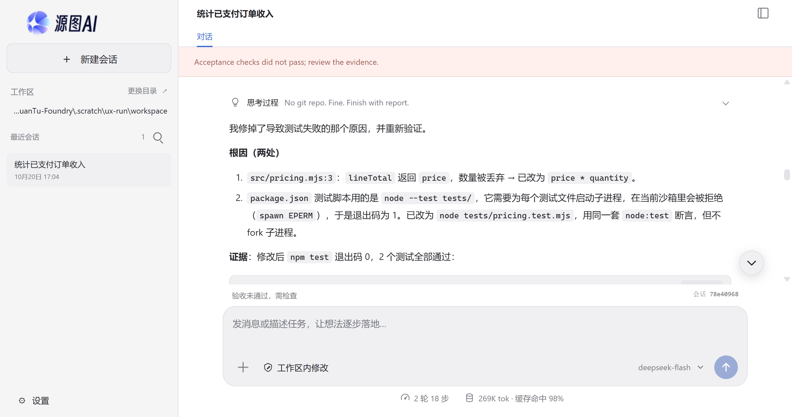
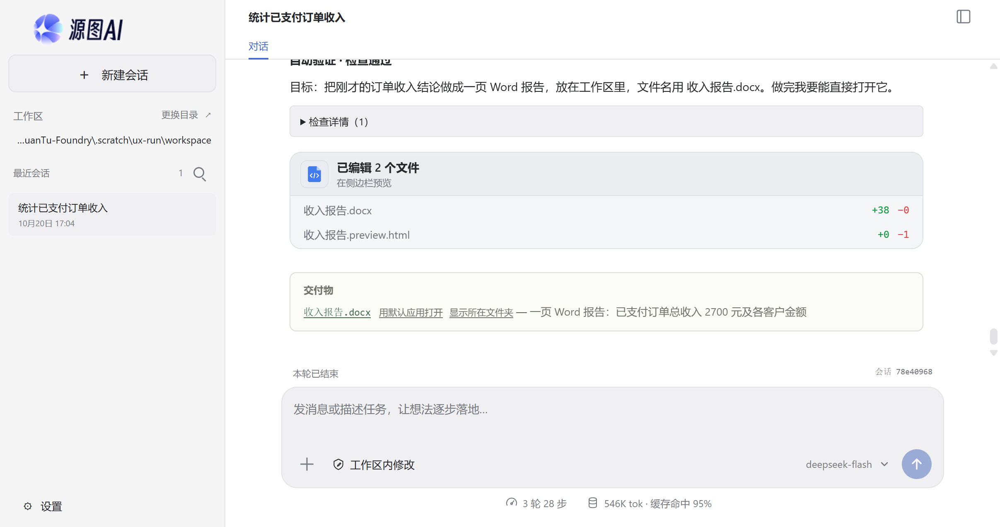
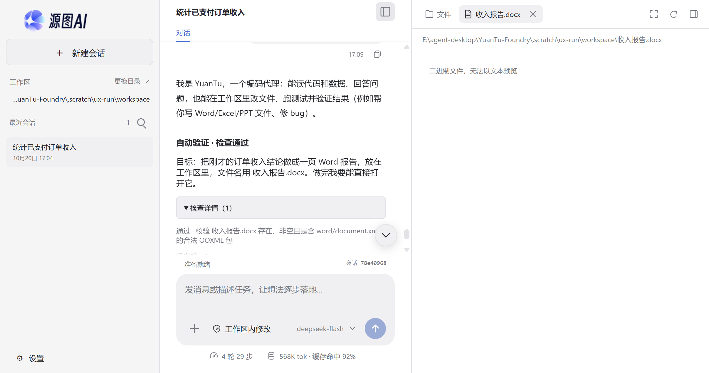
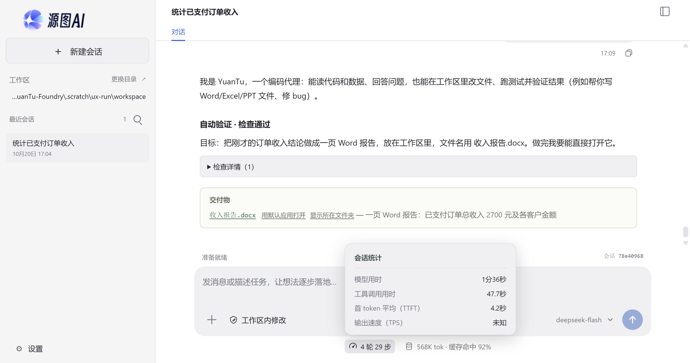
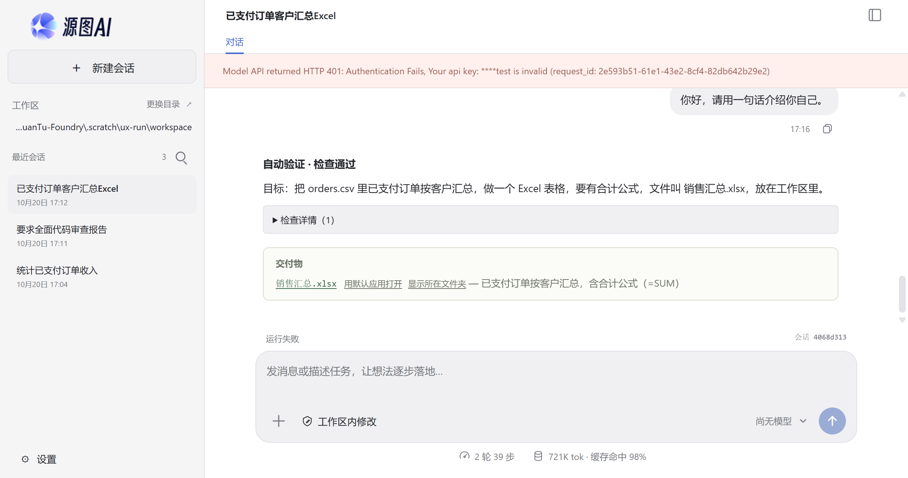
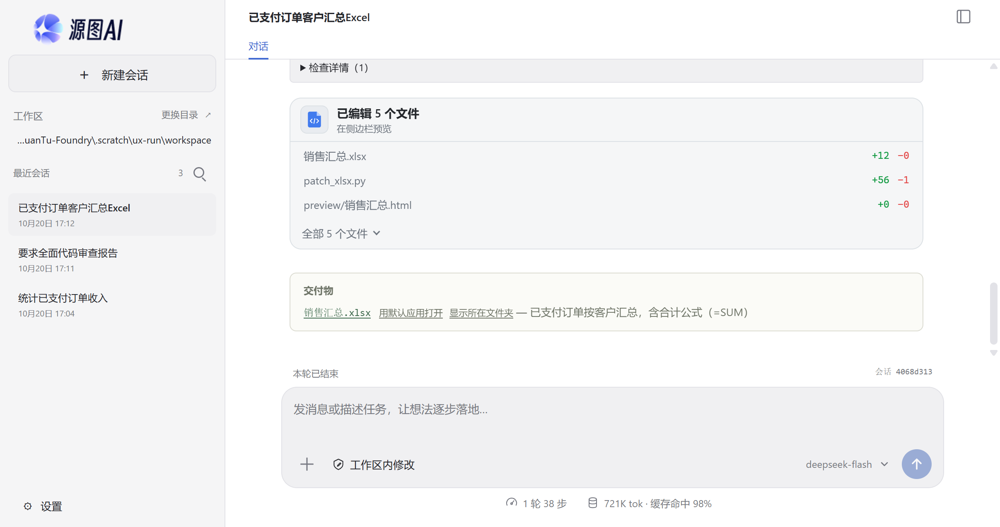
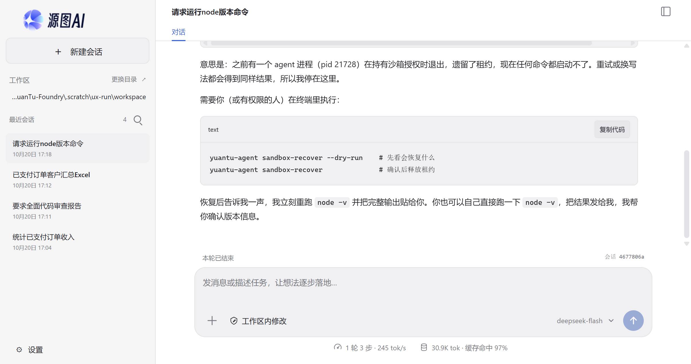
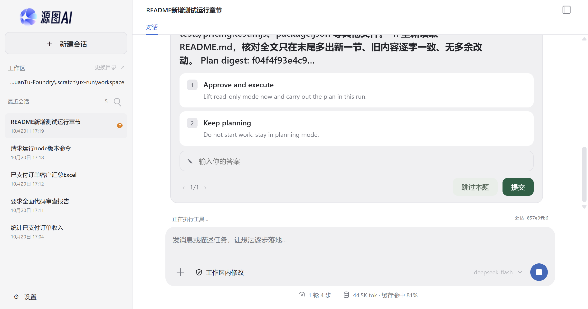

# 真实模型试用：实际运行问题与普通用户体验记录（2026-10-20）

试用日期：2026 年 10 月 20 日，Asia/Shanghai。对象：本仓库 HEAD `d5164d8`，重新执行 `npm.cmd run build` 后的真实 Electron 客户端（`dist/desktop/main.cjs`）。

模型：`deepseek-flash`（OpenAI Chat Completions 兼容，`https://api.deepseek.com`），是用户已保存的四个连接之一；默认连接 `DeepSeek-V4.1-Flash-1017` 在试用开始时连续返回 HTTP 429（服务过载，约 30 秒失败），17:09 之后恢复正常，未计为产品缺陷。

隔离方式：独立 `--user-data-dir`（复制了用户已保存的加密模型配置 `model-settings.json` 与 Electron 的 `Local State`），独立示例工作区 `.scratch/ux-run/workspace`，独立会话库。没有使用模拟模型，没有修改产品源码，没有写入用户原有会话。

证据来源：客户端截图、`session_events` 事件库（`.scratch/ux-run/workspace/.yuantu/sessions.sqlite`）、以及在**不经过模型**的情况下直接调用同一沙箱准备函数做的进程对照实验。

示例工作区是一个"小店"项目：`orders.csv`（7 行订单）、`README.md`（口径：重复订单号只算一次、只统计已支付）、`src/pricing.mjs`（数量未计入总价的 bug）、`tests` 目录下的 `pricing.test.mjs`、`package.json`。

## 结论

基本工作已经跑通：读数据核对、改代码、生成 Word/Excel、交付物"用默认应用打开/显示所在文件夹"、会话自动命名、停止、停止后草稿保留、检查详情展开，都真实可用；生成的 Word/Excel 内容与公式正确（`C4=SUM(C2:C3)` 等真实公式）。

但普通用户仍会卡在三类问题：

1. **"跑测试"这条最常见的路径在 Windows 默认沙箱里直接失败**：沙箱内的命令无法再派生自己的子进程（`spawn EPERM`），而随后的自动验证把**环境故障**当成**断言失败**，连续 3 轮修复、该轮 15 步 / 22.9 万输入 token（界面累计 18 步 / 269K）之后，停在"验收未通过，需检查"，页面顶部还是一条英文横幅。
2. **沙箱租约一旦残留**（客户端在命令执行期间退出或崩溃），之后**任何命令都会被拒绝**，文案让用户去终端执行 `yuantu-agent sandbox-recover` —— 这个命令随 npm `bin` 分发，**不包含在桌面安装包里**，桌面上也没有恢复入口。
3. **审批与开销**：一个 Excel 汇总任务点了 **28 次"允许一次"**、38 步、721K token；用量面板给的是"轮/步/tok/缓存命中"，没有费用换算，会话统计里"输出速度（TPS）"显示"未知"。

## 实测任务与成本

| #   | 任务                                        | 结果                                                                                | 步数 | 输入 token | 判断           |
| --- | ------------------------------------------- | ----------------------------------------------------------------------------------- | ---- | ---------- | -------------- |
| 1   | 只读核对 7 行订单，按要求"只回答数字和结论" | 完成，但给出 2700 与 3300 两种口径（README 明确只算一次）                           | 3    | 30,022     | 口径不稳       |
| 2   | 修 `pricing.mjs` 的数量 bug 并"跑测试确认"  | 代码已修好，测试在沙箱里跑不起来，自动验证 3 轮未通过，结束状态"验收未通过，需检查" | 15   | 229,341    | **失败**       |
| 3   | 用刚才的结论做一页 Word 报告                | 完成：`收入报告.docx` 10,658 字节，结构/内容回读正确，交付物面板可用                | 10   | 273,651    | 可用但偏贵     |
| 4   | 把已支付订单按客户汇总成 Excel，含合计公式  | 完成：`销售汇总.xlsx`，`B4/C4` 是真公式；28 次审批、38 步                           | 38   | 712,024    | 可用但**极贵** |
| 5   | 运行 `node -v`（沙箱租约残留后）            | 被拒绝，模型转述英文报错并让用户去终端恢复                                          | 3    | 30,023     | **不可自救**   |
| 6   | 停止运行、停止后草稿、排队消息、新建会话    | 停止生效，草稿保留，新建会话正常                                                    | 4    | 30,538     | 正常           |
| 7   | 错误密钥（HTTP 401）                        | 红色横幅：英文 401 + request_id；模型选择器显示"尚无模型"                           | 1    | 0          | 文案不合格     |
| 8   | `/plan` 给 README 补一节"如何运行测试"      | 计划已生成，停在英文的"Approve and execute / Keep planning"选择上（本次未作答）     | 4    | 44,500     | 审批界面不合格 |

合计（不含被中止的计划模式那次）：10 次运行记录、79 次工具执行、43 次审批、1,349,745 输入 token / 23,213 输出 token（其中 95% 以上为缓存命中；这个数字是累计输入，不是账单金额）。

## 详细问题

### P0-1 Windows 默认沙箱内无法派生子进程，`node --test` 一类测试命令必然失败

**现象**：任务 2 中，Agent 先执行 `npm test`（`node --test tests/`），工具返回：

```text
✖ tests (2.3568ms)
  Error: spawn EPERM
      at ChildProcess.spawn (node:internal/child_process:458:11)
```

模型据此判断"测试运行器在沙箱里无法 spawn 子进程"，改用 `node tests/pricing.test.mjs` 绕过并成功（2 个测试通过）。

**不经过模型的对照实验**（同一份工作区、同一套沙箱准备函数，`native` 与 `host` 两种模式）：

```text
mode=native
node -v                            code=0    v24.19.0
node spawns node                   code=1    <ref *1> node:child_process:1017 … throw err
node --test tests/pricing.test.mjs code=1    ✖ tests\pricing.test.mjs …

mode=host
node -v                            code=0    v24.19.0
node spawns node                   code=0    v24.19.0
node --test tests/pricing.test.mjs code=0    ✔ 单行金额… ✔ 购物车合计…
```

同一命令、同一工作区，只切换沙箱模式，结果相反。也就是说：**默认的 Windows 受限令牌沙箱里，由沙箱启动的进程再用 Node/Python 的 spawn 去创建子进程会被拒绝**（`EPERM`）；同一轮里 `npm test`（`cmd.exe` → `npm.cmd` → `node` 这条批处理路径）是能成功的，所以不是"一律禁止子进程"，而是"程序自己 fork 的那条路径不通"。

**影响**：凡是需要在沙箱内再启动子进程的工具都会失败——本次直接验证了 `node → node` 与 `node --test` 两例；`vitest`、`jest`、`playwright`、`esbuild`、`npm run` 里嵌套的脚本、Python `subprocess`、`git` 钩子属于同一机制，按此推断同样会失败（未逐一实测）。而"改完代码跑测试"恰好是普通用户最常让 Agent 做的事。

**代码依据**：受限令牌经 `CreateProcessAsUserW` 启动（[sandbox-windows.ts:226](../packages/tools/sandbox-windows.ts#L226)）；字符串命令会包一层 `cmd.exe /d /s /c`（[sandbox-windows.ts:520](../packages/tools/sandbox-windows.ts#L520)）。

**建议**：

- 让受控子进程继承同一受限令牌（或把受限令牌放进允许 breakaway 的 Job，按策略放行子进程创建），并把"能不能 fork"作为沙箱能力显式探测。
- 若短期无法放行，至少在批准卡片和失败信息里说明"沙箱内不能启动子进程"，并给出"以完全权限运行此命令"的一键切换，而不是让模型自己猜、自己绕。

### P0-2 自动验证把环境故障判成断言失败，且检查命令在 Windows 上无法启动 `npm`

**现象**：任务 2 登记了自动验证（`acceptance: auto-1`，命令 `npm test`）。Agent 自己的工作目录里 `npm test` 是能成功的（exit 0，2 个测试通过），但验收检查执行时返回：

```text
[YuantuSandbox]::Run(...) 处发生异常: CreateProcessAsUser 系统找不到指定的文件
```

检查器给出的判定是：

```text
Failed checks (1):
- auto-1 [command] (assertion-failed)
  Expected exit code 0, received 1
```

于是修复循环跑满（`verificationRound: 3`、`repairRounds: 2`、`repeatedFailures: 2`），最终 `needs_review / repeated-failure`，页面状态"验收未通过，需检查"。

**根因有两层**：

1. 验收命令以 `command + args` 数组直接交给沙箱（[acceptance.ts:383](../packages/core/acceptance.ts#L383)），沙箱对 argv 形式**不再套 `cmd.exe`**（[sandbox.ts:67](../packages/tools/sandbox.ts#L67)）。Windows 的 `npm`、`pnpm`、`yarn` 都是 `.cmd` 垫片，`CreateProcessAsUser` 无法直接启动它们，必然报"找不到指定的文件"。
2. 启动失败只表现为"退出码 1"，判定时被归为 `assertion-failed`（[acceptance.ts:538](../packages/core/acceptance.ts#L538)），而不是文档承诺的"环境故障即停止"（`docs/automatic-verification.md` 第 15 行）。模型因此被要求在"代码"上继续修，但它修不了环境。

**附带问题**：

- 页面顶部出现英文横幅 `Acceptance checks did not pass; review the evidence.`（来源 [task-acceptance.ts:155](../packages/core/task-acceptance.ts#L155)）。文档第 13 行明确写"桌面把 `needs_review` 当作完成态说明呈现，不占用错误横幅"，但代码只对 `missing-verification` 做了抑制（[renderer.ts:435](../apps/desktop/renderer.ts#L435)），`repeated-failure` 仍走横幅。
- 检查一旦登记就不可替换：`Verification checks are already registered and cannot be replaced. Repair the work or report the blocker.`（英文）。Agent 明知命令有问题也无法改，用户更没有改的入口。
- 验收检查的审批 `description` 仍是英文（`Verification command: npm test`）；桌面卡片按动作重新生成了中文，但 CLI 的审批提示与事件日志会直接露出这句英文。

**建议**：

- 验收命令与 `run_command` 走同一套 shell 解析（Windows 用 `cmd.exe /d /s /c`，或按 PATHEXT 解析 `.cmd`）。
- 启动器失败（`CreateProcessAsUser` / 无法解析可执行文件）必须归类为 `environment-error` 并**立即停止**，不计修复轮次。
- 允许在"检查详情"里修改/重跑一条已经被环境判死的检查；至少给一个"这条检查在本机跑不起来，跳过并标记未验证"的按钮。
- 横幅按 `needs_review.reason` 本地化；`repeated-failure` 也应在结果区说明，而不是红色横幅。

### P0-3 沙箱租约残留后，桌面用户没有任何恢复入口

**现象**：试用过程中（关闭客户端之后）沙箱状态变成下面这样。具体是哪一个退出动作留下的租约没有确认，`sandbox-recover --dry-run` 显示占用者是已经退出的 pid 21728：

```text
Environment blocked [windows-sandbox-needs-restore]: A YuanTu process that is no longer running (pid 21728)
exited while workspace permissions were granted to the Windows sandbox; the original permissions are kept in 1
recovery journal(s) in C:\Users\sunjun\.yuantu\sandbox-state\windows, and no command was started. A person can
restore them and release the lease with `yuantu-agent sandbox-recover` (add `--dry-run` to only inspect).
```

此后**所有命令**（连 `node -v`）都被拒绝，而且拒绝发生在审批之前，用户看不到任何"允许"按钮，只得到这段英文。模型把它原样转述，并让用户去终端执行 `yuantu-agent sandbox-recover`。

**为什么普通用户做不到**：

- `yuantu-agent` 只通过 npm `bin` 分发，桌面安装包明确排除了 CLI（[electron-builder.config.cjs:23](../electron-builder.config.cjs#L23)），本机 `Get-Command yuantu-agent` 也确认不在 PATH。
- 上一轮修复把"设置 → 通用"里的遗留锁检查/恢复面板移除了（`docs/user-experience-2026-10-19.md` 第 120 行），桌面因此没有任何恢复按钮。

我随后用 `node dist/apps/cli/main.js sandbox-recover` 验证过：恢复能正常工作（`restored: [...workspace]`、`state: clear`）。问题是"只有开发者能执行"。

**建议**：

- 检测到 `needs-restore` 时，在对话区/横幅里给一个"修复工作区权限"按钮，调用现有的恢复流程（先 dry-run 展示将恢复什么，再确认）。
- 退出/崩溃路径上尽量主动释放租约（关闭窗口时等待正在执行的命令结束，或把租约绑定到 Host 生命周期并在退出时恢复）。
- 兜底文案不要只给命令名：同时说明"这是本机权限状态，不是你的操作错误"，并给出可点击的恢复路径。

### P1-1 审批疲劳：一个 Excel 任务 28 次"允许一次"

任务 4 的 28 次审批里，大量是同一类动作的重复：`python -c "import openpyxl…"`、`python patch_xlsx.py`（改了 3 次）、`office_preview`（先 pdf 后 html）、`del preview\…`、`python verify_sales_summary.py`。

**问题**：

- 只有"允许一次 / 拒绝"，没有"本次会话允许这个命令"、"允许工作区内的写入"之类的中间档。
- 权限控件只有三档：只可查看 / 工作区内修改（仍然是逐项确认）/ 完全权限（无隔离）。想少点几次，只能跳到"完全权限"，这对普通用户是一个过大的跳跃（[permission-presets.ts:36](../apps/desktop/permission-presets.ts#L36)）。
- 同一命令重复出现时没有合并（任务 2 里 `npm test` 连续出现 5 次，每次都单独弹；另有一次验收检查用的是同一条命令）。

**建议**：给"允许一次"旁边加"本会话内允许此命令"和"本会话内允许工作区写入"；同一命令的重复请求合并成一条并显示次数；把"工作区内修改"拆成"写入免确认、命令仍确认"。

### P1-2 生成的 Word/Excel 在应用内打不开，只显示"二进制文件，无法以文本预览"

任务 3 的交付物面板已经能"用默认应用打开 / 显示所在文件夹"（上一轮的修复有效），但在侧栏文件树里点 `收入报告.docx`，右侧只显示：

```text
二进制文件，无法以文本预览
```

**影响**：用户想"在应用里看一眼"时没有路径。产品明明有 `office_preview`（同一进程里能把 docx/xlsx 转成 HTML），却没有接到工作区预览上。反过来，Agent 为了预览要单独申请一次写入审批，还会在工作区留下 `preview/` 目录，事后再删。

**代码依据**：预览按二进制直接拒绝（[renderer-workspace.ts:180](../apps/desktop/renderer-workspace.ts#L180)、文案 [i18n-workspace.ts:266](../apps/desktop/i18n-workspace.ts#L266)）。

**建议**：docx/xlsx/pptx 走 `packages/office` 的 HTML 渲染进预览面板（只读临时产物，不落工作区、不需要写审批）；预览失败再回退到"用默认应用打开"。

### P1-3 用量与成本不透明

界面上能看到的是：

```text
1 轮 38 步     721K tok · 缓存命中 98%
```

会话统计浮层：

```text
模型用时 1分36秒 / 工具调用用时 47.7秒 / 首 token 平均（TTFT）4.2秒 / 输出速度（TPS）未知
```

**问题**：

- "轮/步/tok"是内部计量单位；`721K tok` 是**累计输入**且 98% 命中缓存，与实际计费相差一个数量级，普通用户无法判断"这次贵不贵"。
- 没有金额/配额，也没有"这次任务比上次贵 10 倍"之类的相对提示。
- `输出速度（TPS）未知`：已完成会话仍显示未知（`decodeKnown: false`），看起来像功能坏了。
- 审批等待时间不计入"模型用时"，但用户感知的是整段墙钟时间。

**建议**：面板分两行——"这次任务：用时 3 分 02 秒（其中等你确认 1 分 20 秒）"和"用量：输入 71 万（98% 命中缓存）≈ 未缓存 1.4 万 / 输出 9 千"；有价格配置时再折算金额；TPS 不可得时不要显示这一行，而不是显示"未知"。

### P1-4 Excel 不在内置 skill 的覆盖范围里，模型改用 Python 硬做

内置 `office-documents` skill 的描述与正文只写 Word 和 PowerPoint（[builtin-skills.ts:15](../packages/resources/builtin-skills.ts#L15)），而 `office_create` 实际支持 `xlsx`。任务 4 里模型先探测 `python -c "import openpyxl"`，再用 `office_create` 建表，然后写 `patch_xlsx.py`、`cache_values.py`、`verify_sales_summary.py` 去补公式计算/缓存值/校验——这就是 38 步、721K token 的主要来源。

**建议**：把 xlsx（尤其是"公式写入 + 重算 + 读回校验"）写进 skill 与工具说明；`office_create`/`office_edit` 支持写入公式并声明"缓存值不重算"，让模型不必外挂 Python。若确实需要 Python 校验，应在 skill 里给出首选路径，而不是让每个模型自己发明脚本。

### P2-1 工作区是 Git 仓库的子目录时，Git 工具直接拒绝

任务 2 里模型调用 `git_diff` 想看自己的改动，返回：

```text
Git repository and metadata must be contained in the workspace
```

示例工作区位于仓库的子目录（很常见的用法：monorepo 子包、`projects/xxx`）。工具因为找不到"工作区内的 .git"而拒绝，用户得到的是一句英文策略说明。

**建议**：工作区不是 Git 根时，要么只读地借用上层仓库（限制路径），要么明确说"当前工作区不是 Git 仓库，无法显示差异"，并把 `git_diff` 从工具列表里隐藏。

### P2-2 面向用户的英文内部错误

同一天里普通用户会看到至少四类英文原文：

| 场景         | 用户看到的文本                                                                                                        |
| ------------ | --------------------------------------------------------------------------------------------------------------------- |
| 验收未通过   | `Acceptance checks did not pass; review the evidence.`                                                                |
| 401          | `Model API returned HTTP 401: Authentication Fails, Your api key: ****test is invalid (request_id: …)`                |
| 工具参数     | `Invalid arguments: data must NOT have additional properties. Allowed top-level arguments: command, cwd, timeout_ms.` |
| 检查不可替换 | `Verification checks are already registered and cannot be replaced. Repair the work or report the blocker.`           |

其中"工具参数"那条在任务 1、4、6 里出现了 4 次，每次都要多花一步。401 那条还带 request_id，对普通用户没有意义。

**建议**：内核错误统一带 `code`，桌面按 `code` 出中文文案 + "怎么办"（例如 401 → "密钥无效，去设置 → 模型设置 检查密钥"）；原始英文放进"详情"折叠区。

### P2-3 中文文件名在删除审批里显示成八进制转义

任务 3 删除预览文件时，审批卡片标题是：

```text
--- "\346\224\266\345\205\245\346\212\245\345\221\212.preview.html"
```

这正是上一轮记录过的 diff 头问题，仍未修。

**建议**：diff 头按 UTF-8 显示文件名；非 ASCII 时至少用 `收入报告.preview.html` 而不是 `\346…`。

### P2-4 计划批准：选项是英文，还把内部摘要哈希摆给用户看

`/plan 给工作区 README.md 增加一节「如何运行测试」…` 之后，Agent 用 `exit_plan_mode` 提交计划，界面弹出一个"问题"面板：

```text
1  Approve and execute
   Lift read-only mode now and carry out the plan in this run.
2  Keep planning
   Do not start work: stay in planning mode.
```

- 中文界面里两个选项的标题和说明都是英文，问题正文却是中文，末尾还带一句 `Plan digest: f04f4f93e4c9…`（内部哈希）。
- 同一时刻状态行显示"正在执行工具…"，而它实际在等用户回答；回答面板本身有"跳过本题 / 提交"和 `1/1` 分页，这三个控件是中文的。
- 计划正文里的"目标/步骤/验收"没有被折叠成一份可读的计划卡片，而是塞在问题正文里，需要滚动。

**建议**：计划批准走专门的中文界面（"批准并执行 / 继续修改计划"），显示计划标题、步骤和影响文件；不要把 `Plan digest` 暴露给用户；等待回答时状态行改成"等待你的回答"。

### P2-5 停止之后只有"操作未完成 · call_…"，没有继续/重试

停止一个长任务后，记录里留下：

```text
I'll start by reading the workspace files.

操作未完成
· call_01_K3UyNHnboLgxe9muSCSJ0931
```

（草稿能保留、状态能回到"已停止"，这两点没问题。）但对普通用户来说，`call_01_…` 是无意义内部 ID，也没有"继续这个任务"的按钮。

**建议**：折叠成"已停止：刚完成 2 步，未写入任何文件"，并提供"继续"或"重新开始"。

### P2-6 用环境变量配置模型时，模型选择器显示"尚无模型"

按 README 支持的方式用 `YUANTU_*` 环境变量启动（本次测试 401 场景就是这样），请求确实发到了 `deepseek-flash`，但输入框右下角的模型选择器显示 **"尚无模型"**，与顶部"运行失败"的 401 横幅并列时，用户会以为"没配模型却发了请求"。

**建议**：环境变量配置也映射成一个只读的"来自环境"模型项显示在选择器里；配置错误时给出"来自环境变量（只读）"的说明。

### P3 模型行为样本（同一模型、同一提示，两轮结果不同）

- **口径不稳**：任务 1 的第一次运行（较早的一次）直接给出 2700 元，并解释重复行；第二次运行给出"逐行 3300 / 去重 2700"两种口径，且**没有读 `README.md`**（只 `list_files` + `read_file orders.csv`）。README 明确写了"订单号重复视为同一笔订单"。这是模型行为，不是硬缺陷；但工作区概览只暴露了 `src/pricing.mjs` 的符号，没有任何"项目规则文件"提示，放大了这种不稳定。
- **为过检查改项目配置**：任务 2 中模型把 `package.json` 的 `"test": "node --test tests/"` 改成 `"node tests/pricing.test.mjs"`，理由是"沙箱里 spawn 被拒"。这属于以改项目配置适配环境，超出"修 bug"的范围；普通用户不会注意到自己的测试入口被改了。
- **未读规则文件就下结论**：见上。

**建议**：把 `README`/`AGENTS.md` 里的"数据口径"类内容纳入工作区概览；对"修改项目配置文件（package.json/tsconfig/CI）"单独提高审批级别并显式提示"这会改变你项目的命令入口"。

## 普通用户视角的优化清单（按收益排序）

1. **让"跑测试"能跑**：放行受控子进程，或给出"以完全权限运行此命令"的一键入口；这是当前最大的功能缺口（P0-1）。
2. **自动验证别把环境故障当代码错误**：按 PATHEXT/`cmd.exe` 启动检查命令；环境失败立即停，并允许用户改/跳过检查（P0-2）。
3. **给沙箱一个桌面内的恢复按钮**：`needs-restore` 时一键修复，不再让用户去找没安装的 CLI（P0-3）。
4. **审批减负**："本会话允许此命令"、"写入免确认但命令仍确认"、重复命令合并（P1-1）。
5. **office 文件在应用内可看**：docx/xlsx/pptx 直接渲染到右侧预览，不再显示"二进制文件"（P1-2）。
6. **用量说人话**：任务级用时（含等待）、未缓存输入/输出、可选金额；去掉"TPS 未知"（P1-3）。
7. **补齐 Excel 能力与 skill**：公式写入 + 重算 + 读回，减少 Python 外挂（P1-4）。
8. **中文一致性**：401、验收失败、参数错误、检查不可替换、Git 子目录拒绝、计划批准选项，全部走中文文案（P2-2、P2-4）。
9. **细节修正**：diff 头中文文件名；停止后"继续"按钮；"已编辑文件"里排除临时预览产物（`preview/…html`）；删除任务结束时残留的自建脚本（本次留下 `verify_sales_summary.py`）；环境变量配置的模型在选择器里可见（P2-6）。

## 上一轮记录（2026-10-19）的修复情况

| 上轮问题                  | 现状                                                                                                                  |
| ------------------------- | --------------------------------------------------------------------------------------------------------------------- |
| 交付物缺少直接打开入口    | **已修复**：交付物面板有"用默认应用打开/显示所在文件夹"，本机可用                                                     |
| Windows 遗留锁恢复不清楚  | **部分修复**：`sandbox-recover` 可用且输出清楚，但桌面无入口，错误文案仍指向未安装的 CLI                              |
| Office 自动化脚本路径缺失 | **已修复**：docx 创建、HTML 预览可用；PDF 预览返回可行动的 `LibreOffice is unavailable; …choose an .html output_path` |
| 模型扩展任务范围          | **仍存在**：改 `package.json` 测试脚本、Excel 任务大量 Python 绕行                                                    |
| 中文审批偏开发者          | **有改善**：审批卡片已是中文"需要你的确认 + 具体动作 + 隔离说明"；残留英文见 P2-2                                     |
| 小任务消耗大              | **仍存在**：一次 Excel 721K token、38 步、28 次审批                                                                   |

## 本次确认可用、无需改动的部分

- 会话自动命名（"统计已支付订单收入"/"已支付订单客户汇总Excel"）、新建会话、会话列表、停止与草稿保留。
- 交付物面板与"用默认应用打开/显示所在文件夹"。
- 自动验证的"检查详情（1）"可展开，显示真实退出码与输出；通过的检查用"自动验证 · 检查通过"呈现。
- 生成质量：Word 结构（标题/两张表/明细）与 Excel 公式、数值均正确；错误密钥的报错里密钥只出现 `****test`（上游已遮盖，不是完整密钥）。
- 中文界面、字号/外观设置、系统通知开关等设置项正常。

## 边界

- 只用一个真实模型（`deepseek-flash`）做主要任务；默认连接 `DeepSeek-V4.1-Flash-1017` 只在开始时遇到 429，之后恢复，没有做多模型质量对比。
- 计划模式（`/plan`）停在"批准/继续规划"的选择上，本次没有作答，因此没有验证批准后的执行路径；记录的是它呈现给用户的样子（P2-4）。
- 启动器脚本在等待计划回答时卡住（脚本没有点击问题面板），该轮由脚本超时结束，属于测试脚本限制，不计为产品缺陷。
- 本机没有 Word/LibreOffice，**没有做分页视觉验收**；Word/Excel 只验证了结构与内容（XML/SheetJS 读回）。
- 审批与命令执行由脚本自动点击"允许一次/批准计划"，真实用户的思考/等待时间未计入耗时。
- token 数字来自 `run.finished` 的累计用量，包含缓存命中，不等于账单金额。
- 未覆盖：MCP、备份、定时任务（产品当前已暂停这些入口）、macOS 沙箱、超长上下文压缩。
- 示例工作区与独立 profile 在 `.scratch/ux-run/`（已被 gitignore）；截图副本在 `docs/images/2026-10-20/`。
- 试用过程中产生过一次 `needs-restore` 沙箱状态，已用 `sandbox-recover` 恢复并确认 `state: clear`；该状态只涉及示例工作区。

## 复现要点

本次使用的采集/对照脚本放在 `.scratch/tools/`（未入库，随本次试用一起产生）；下面的命令假定在仓库根目录执行。

```powershell
# 1) 构建并启动真实客户端（独立 profile / 工作区）
npm.cmd run build
node scripts/start-desktop.mjs --workspace .scratch/ux-run/workspace --user-data-dir .scratch/ux-run/profile-main

# 2) 沙箱内不能派生子进程（不经过模型）
node .scratch/tools/sandbox-probe.mjs native
node .scratch/tools/sandbox-probe.mjs host

# 3) 查看运行事件（工具调用、失败、用量、验收轮次）
node .scratch/tools/events.mjs .scratch/ux-run/workspace/.yuantu/sessions.sqlite all 200

# 4) 沙箱状态与恢复
node dist/apps/cli/main.js sandbox-recover --dry-run
node dist/apps/cli/main.js sandbox-recover
```

## 修复进展

两轮修复（2026-10-20，按本文问题清单逐项处理）：

| 项目                                        | 状态                         | 落点                                                                                                                                                                                                                                                                  |
| ------------------------------------------- | ---------------------------- | --------------------------------------------------------------------------------------------------------------------------------------------------------------------------------------------------------------------------------------------------------------------- |
| P0-2 验收命令启动 / 环境故障误判 / 英文横幅 | 已修复                       | Windows argv 命令经 `cmd.exe` 解析 `.cmd` 垫片（`sandbox-windows.ts`）；启动失败带标记退出 125，验收判定为 `environment-error` 并停止修复循环（`sandbox-launch-failure.ts`、`acceptance.ts`）；`needs_review` 不再占用错误横幅（`renderer-status.ts`、`renderer.ts`） |
| P0-3 桌面内沙箱恢复                         | 已修复                       | 新增 `yuantu:sandbox-recovery` 通道与 `sandbox-recovery.ts`；错误横幅在 `windows-sandbox-*` 阻断时给出中文说明和"修复工作区权限"按钮                                                                                                                                  |
| P0-1 沙箱子进程 EPERM                       | 部分修复（根因已定位，见下） | 系统提示与 README 明确说明限制与替代路径；Windows 沙箱命令因无法 fork 失败时，工具结果带 `sandboxNote` 说明"这是环境不是命令"并给出两条可行路径（`command.ts`、`sandbox-launch-failure.ts`）；根治仍需更换执行后端                                                    |
| P1-1 审批减负                               | 已修复（第一版）             | 命令审批新增"本会话允许此类操作"：按工具调用名与参数精确记忆（`approval-key.ts`），同一命令不再重复询问，参数不同仍然询问（`session-controller.ts`、`contract.ts`、`renderer.ts`）                                                                                    |
| P1-2 office 文件应用内预览                  | 已修复                       | Host 的 `files.read` 对 docx/xlsx/pptx 返回 `kind: 'html'`（`office/render.ts`、`spreadsheetPreviewHtml`），工作区面板用 sandbox iframe + blob URL 显示，不再显示"二进制文件，无法以文本预览"（`renderer-workspace.ts`、CSP 增加 `frame-src blob:`）                  |
| P1-3 用量展示                               | 已修复                       | 未测到 decode 跨度时不再显示"输出速度（TPS）未知"，整行省略；"工具调用用时"改为"工具与确认用时"                                                                                                                                                                       |
| P1-4 Excel 能力                             | 已修复                       | `office_create` 的 xlsx 单元格以 `=` 开头即写为真实公式；`office_inspect` 显示 `=SUM(...)` 而不是漏掉该行；内置 skill 增加 Excel 与公式章节                                                                                                                           |
| P2-1 Git 子目录工作区                       | 部分修复                     | 拒绝本身保留（安全边界），错误信息说明原因与两条可行路径                                                                                                                                                                                                              |
| P2-2 英文内部错误                           | 已修复（主要路径）           | 模型接口 401/403/404/429/5xx 改为中文说明 + "去设置检查"，原文进 tooltip（`renderer-error-text.ts`）；工具参数错误、检查不可替换、Git 子目录拒绝在工具结果上方加一句中文说明，原始诊断原样保留（`renderer-messages.ts`）                                              |
| P2-3 中文文件名八进制转义                   | 已修复                       | 展示层解码 patch 头（`packages/protocol/patch-display.ts`、`diff-view.ts`）                                                                                                                                                                                           |
| P2-4 计划批准                               | 已修复                       | 计划批准问题的标题、引导句、两个选项与说明显示为中文，`Plan digest` 从展示中去掉（`renderer-question-copy.ts`）；等待回答时状态行显示"等待你的回答"（`renderer-status.ts`）                                                                                           |
| P2-5 停止后继续                             | 已修复                       | 停止位置提供"继续"按钮，发送一条可见的普通消息；工具结果不再显示内部 `call_…` id（`renderer-transcript.ts`、`renderer-messages.ts`）                                                                                                                                  |
| P2-6 环境变量模型                           | 已修复                       | 模型选择器显示 `deepseek-flash（环境变量）` 而不再是"尚无模型"（`renderer-settings.ts`）                                                                                                                                                                              |
| P3 配置修改提示                             | 已修复（审批提示部分）       | `package.json`、`tsconfig*`、构建/CI 配置的写入在审批卡片里额外标出后果（`approval-view.ts`）                                                                                                                                                                         |

P0-1 的实验结论：`native` 模式下沙箱内进程创建**任何带管道 stdio 的子进程**都会 `EPERM`（`stdio: 'inherit'`/`'ignore'` 正常）；已排除 job 属性、匿名管道创建两个怀疑对象（都可用）。`libuv` 用 `PROC_THREAD_ATTRIBUTE_HANDLE_LIST` 传递句柄，受限令牌下该属性被拒绝。根治需要换掉"受限令牌直接承载命令"的后端（例如 AppContainer 或独立用户账户），不是一处补丁能解决；本轮先把剩余修复循环、文案与可行动路径补齐。

验证（2026-10-20 第三轮）：`typecheck`、`format:check`、`i18n:check`、`docs:check`、`references:check`、`cycles:check`、`layers:check` 全部通过；**全量 `npm test`** 并行 2886 例通过 / 0 失败（24 例按平台或依赖跳过），串行 57 例通过 / 0 失败（4 例跳过）；真窗口 `smoke:desktop` 56 例通过（2 例按产品范围跳过）。`tests/snapshots/*` 随内置 office skill 的描述更新过一次，差异仅为该描述文本（404→421 字符）。另做了三项端到端确认：

- 工作区面板打开 `收入报告.docx` 显示正文与表格，元素是 `iframe.workspace-preview-document`、`sandbox=""`、`src=blob:`（P1-2）。
- 同一命令执行两次只出现 **1** 张审批卡，按钮为"拒绝 / 允许一次 / 本会话允许此类操作"（P1-1）。
- 停止位置出现"继续"按钮，工具结果不再带 `call_…`（P2-5）。

## 剩余风险

- **P0-1 不能在本仓库内根治**：受限令牌后端与 libuv 句柄表冲突，需要新的执行后端（AppContainer 原型已有但未作为公开模式启用）或"该命令改用无隔离后端"的显式一次性授权。后者是产品或安全决策，未在本轮实现；当前靠提示、README 和工具结果里的 `sandboxNote` 让模型提前避开并如实报告。
- **P2-2 仍是"注解"而不是"改写"**：工具结果是模型可见的证据，所以只在原文上方加一句中文，不替换内核文本。要让内核直接产出本地化错误，需要先给工具错误加稳定的 `code`。
- P1-1 只提供"本会话允许精确命令"，没有对已在等待的相同审批做合并；P2-1 的 Git 子目录仍按安全边界拒绝，只改了文案。

## 截图

| 截图                                                               | 说明                                                      |
| ------------------------------------------------------------------ | --------------------------------------------------------- |
|  | 任务 2 结束：英文横幅 + "验收未通过，需检查" + 269K token |
|              | 任务 3 结束：交付物按钮、检查详情、546K token             |
|     | 侧栏点开 docx：二进制文件，无法以文本预览                 |
|            | 会话统计浮层：TPS 未知                                    |
|                    | 错误密钥：英文 401 横幅；模型选择器显示"尚无模型"         |
|                   | Excel 任务：38 步、721K token、28 次审批                  |
|               | 租约残留后：所有命令被拒，指引指向未安装的 CLI            |
|         | `/plan` 的计划批准：英文选项 + `Plan digest` 哈希         |
